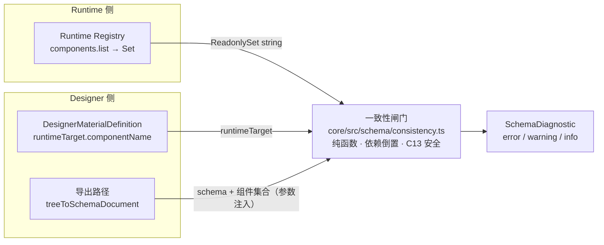

# Form Engine V2 架构方案二次审核报告（第一性原理）

> 审核对象：`01-form-engine-v2.md`（融合架构设计方案）、`02-form-engine-v2-task.md`（改造任务书）及 Phase 0–6 实际代码
> 审核方式：第一性原理还原 + 源码事实核对（`file:line` 级证据）
> 审核日期：2026-11-13（S1/S2 于同日二次源码核对后修订）
> 前序文档：`03-form-engine-v2-review.md`（C1–C9 事实核查 + Q1–Q9 决策锁定）
> 结论：**方向与边界纪律正确。真正创造价值的「Material → Schema → Runtime 一致性闭环」已在 `core` 就位（依赖倒置、C13 安全），但导出路径尚未调用它——属「未接线」而非「悬空」；Phase 2–6 建出的新 Designer 栈能 mount 画布，却缺 Workbench UI 装配层（SettingsForm / 物料面板 / 工具栏），无任何可运行 demo，统一切换却仍按 Phase 9 一次性 big-bang 推进。这两项是本轮必须前置处理的风险。**

---

## 1. 审核范围与方法

`03` 已完成了**事实层**（文档 vs 代码的 `file:line` 核查，C1–C9）与**决策层**（Q1–Q9 决策锁定）。本报告在此之上做**架构层**审核：把方案剥到第一性原理，回答「这个方案究竟在解决什么、它引入的抽象是否成立、最大风险在哪」，并用 Phase 0–6 落地后的代码反推这些判断是否仍然成立。

方法：

1. 还原方案本质：从目标反推，识别「新建物」与「保留物」的边界。
2. 逐个审查核心架构决策（Material 一等公民、双引擎隔离、可替换 Adapter）的代价与前提。
3. 用当前代码状态验证「可验证」原则是否在**集成层**（而非仅单元测试层）得到满足。
4. 按优先级给出建议，每条落到具体文件或具体宿主包。

权威原则沿用仓库既有规则：**代码 > 文档**。

---

## 2. 方案本质（第一性原理还原）

剥掉术语后，本方案只做两件「新」事：

1. **新建 Designer 框架**：Material / Setter / Plugin / Panel / Command / Toolbar Registry + DesignerEngine + SchemaEditor，把 Designable 隔离成可替换 Adapter。
2. **新建一致性闭环**：让「设计师画的 schema」能被 Runtime 正确解析与渲染。

其余（Runtime、ComponentBinding、Snapshot、Permission、Readonly）均为保留，不是本轮工作。

方案最核心的架构决策是 **Q4 / C4：`DesignerMaterialDefinition` 是「一等公民」，与 `ComponentBinding` 分离**。该决策本身成立——确实存在 `designer-only` 节点（布局容器、分割线）没有 Runtime 组件，物料也携带 design-only 元数据（`title` / `icon` / `category` / `setters`）。**但它的代价是制造了「组件身份」的第二份真相**：同一个逻辑组件（如「Input」）在 `ComponentBinding`（Runtime 侧）与 `DesignerMaterialDefinition`（Designer 侧）各描述一次，二者仅靠一个裸字符串 `componentName` 对齐。方案中的 Phase 7 一致性闭环，本质上是在重建被这个分离破坏掉的一致性。这正是方案自己承认的 R2：「画了、Runtime 渲染不出」。

从第一性原理看，**方案的真正价值不在「拆包」或「注册表数量」，而在这个一致性闭环是否成立**。因此审核重心应放在：这个闭环是否被真正接线进导出路径，以及它有没有被真正跑起来验证。

---

## 3. 已确认的正确执行

以下事实经源码核对成立，是方案里最扎实的部分：

| 项 | 证据 | 评价 |
|---|---|---|
| `types` 包纯度纪律 | `packages/types/src/designer.ts` 全程 `unknown` 占位（`icon` / `designerComponent` / `component`），`createSchema` 返回 `Record<string, unknown>`，`schema` 字段没收窄为 `ISchema`（`schema.ts:25`） | 最难守的约束守住了，未耦合 Formily / Designable / React |
| C6 诚实性 | `restoreSnapshot` 仅类型声明、Canonical 后端协作始终未标为已完成（`component.ts`） | 未把规划能力标成已实现 |
| Generic Plugin Core 真抽取 | `packages/core/src/plugin/generic/{plugin-host,dependency-resolver}.ts` + `no-business-deps.test.ts` 依赖守卫 | 不是复制 Runtime Plugin Manager |
| C5「不静默跳过」落地 | `material-registry.ts:23-49` 注册期诊断；`derive-materials.ts:33-40` 缺 `implementations.pc` 产生 warning | 诊断能力已进生产代码，非纸面 |
| 一致性校验原语已实现 | `packages/core/src/schema/consistency.ts`（`checkSchemaComponentRegistrations` + `checkMaterialRuntimeTarget`，依赖倒置） | 见 §4.1 |

---

## 4. 核心发现与建议

### 4.1（S1，最关键）一致性闭环：已就位、未接线（宿主是 `core`，不是 `sdk`）

> 本条是对审核初稿的修订：初稿称一致性校验「被 C13 悬空、无宿主、建议落 sdk」。经二次源码核对，该判断有误——校验函数已在 `core` 依赖倒置落地、C13 安全；真实缺口是导出路径未调用它们。

**事实（已就位）**：`packages/core/src/schema/consistency.ts` 已实现：

- `checkSchemaComponentRegistrations(schema, components, decorators)`（Task 7.3，schema→runtime 组件存在性）。
- `checkMaterialRuntimeTarget(material, components)`（Task 7.1，material→runtime 映射）。

两者只 import `@x-form-engine/types` 与 `./diagnostics`，通过参数 `ReadonlySet<string>` 接收组件名集合，从不 import designer-core 或 Runtime Registry——**依赖倒置使 `core` 成为共享宿主，且不违反 C13**。Phase 7.4 的 8 条 Contract Tests 也已在 `designer-designable/src/__tests__/contract.test.ts` 落地。

**事实（未接线）**：全仓库 grep 确认 `checkMaterialRuntimeTarget` 与 `checkSchemaComponentRegistrations` **只被测试调用，无生产调用点**。设计器导出路径 `packages/designer-designable/src/schema-adapter.ts:23-47` 的 `treeToSchemaDocument` 只做结构校验（`validateEngineSchema`，:31-34），**不做组件注册校验**。因此「画了 → 导出成功 → 渲染时才暴露组件未注册」的洞仍在，但补法很小。

**第一性原理（修订）**：一致性校验若要生产期生效，宿主应是「能同时被 runtime 与 designer 依赖、且本身不含业务上下文」的 `core`——它已满足且已实现。真正的缺口不是「找个包」，而是「把已有纯函数接进导出路径」。初稿建议的 `sdk` 是错误宿主：`sdk` 是 runtime 公开入口，`packages/sdk/package.json` 不依赖 designer-core，且有 `no-designable-dep.test.ts` 守卫；放 sdk 会强迫 runtime→designer 依赖，违反「Runtime 可独立使用、不加载 Designer」。

**建议（修订）**：
1. 在 `core` 追加组合闸门 `validateDesignerExport(doc, { components, decorators }): SchemaDiagnostic[]`，内部组合 `checkSchemaComponentRegistrations` + `checkMaterialRuntimeTarget`。
2. 在 `treeToSchemaDocument` 扩展 `{ components, decorators }` 参数（或由导出命令传入），组件集合由 app 从 `engine.registry.components.list()` 派生。零新增包、零违反 C13、不改 runtime 侧。

### 4.2（S2）新栈能 mount 画布，但缺 Workbench UI 装配层，仍按 Phase 9 才接线

> 本条同样是对初稿的修订：初稿定性为「集成风险 / 接线」。二次核对后，真实缺口是「UI 装配层被主动推迟到 Phase 9」，比集成风险更具体、更迫切。

**事实（画布能起）**：`packages/designer-designable/src/adapter.ts:33-98` 的 `createWorkspace` 创建真实 Designable engine，`mount()` 确实 `ReactDOM.render(<Designer><Workbench><WorkspacePanel><ViewportPanel/></WorkspacePanel></Workbench>, container)`。画布能 mount。

**事实（但不可用）**：这个 Workbench 是最小集——只有 WorkspacePanel + ViewportPanel，**没有 SettingsForm、没有物料资源面板（ResourceWidget/CompositePanel）、没有工具栏宿主**，mount 出来是块空画布，连拖入物料的入口都没有。逐条看：

- `setter-adapter.ts:27-49` 产出 setter 的 `components` map，但**无任何地方渲染 SettingsForm**——map 是「给 SettingsForm 用的组件表」，SettingsForm 本身不存在。
- `plugins-basic/src/plugins.ts:7` 的面板/工具栏组件是 `const PanelPlaceholder = () => null`，注释明写「Phase 6 只注册定义，具体 UI 由 Phase 9 / demo 提供」——**四个插件全是空壳占位**。
- `designer-core/src/engine.ts:61-69` 的 `use(adapter)` 只存 adapter，不 `createWorkspace`、不 mount，挂载需 app 手动做。
- `apps/designer-demo/package.json` 仍依赖旧 `@x-form-engine/designer`，`App.tsx:29` 从旧包 import；仓库内无任何 app 引用新栈。

**第一性原理（修订）**：S2 的真实性质不是「集成接缝风险」，而是「可用设计器的 UI 装配层被方案明确推迟到 Phase 9」，这个装配层恰恰是新栈唯一没做、旧 `packages/designer` 已全套具备的东西（DesignerPreview / exportSchemaDocument / importSchemaDocument / OptionsSetter / 完整 Workbench）。在 base 不可用的情况下继续推 Phase 8 高级扩展，等于在没有可用地基上盖楼。

**建议（修订）**：把 demo 前移，分两层：

1. **最小可跑闭环**：用 `adapter.mount` 出画布 + 补一个 SettingsForm 宿主 + 一个物料资源面板 + 导出按钮，证明「拖入→改属性→导出→被 Runtime 渲染」一条链。现在就能做。
2. **UI 装配层本身**：按 Task 6.3 明确要求「现有 Designer 已实现相应功能，应迁移或包装，不得重新实现一套平行功能」，把旧 `designer` 的 Workbench 迁过来而非从零重写。真正的集成风险在旧 Workbench 的 TreeNode/事件边界与新 adapter 对齐——这是 Phase 9 才会踩的坑，应前移到此刻暴露。

### 4.3（S3）「双源」用裸字符串对齐，derive 路径正确，free-register 路径重新打开 drift

**问题**：物料有两条注册路径：

- `deriveDesignerMaterials`（`packages/materials-basic/src/derive-materials.ts`）：从 `ComponentBinding` 派生，`componentName` 与 `runtimeTarget.componentName` 天然一致——单源、安全。
- `materialRegistry.register(material)`：自由手写——双源、靠字符串对齐。

4.1 的 drift 即由后者引入。

**建议**：`component` 类物料不靠「手写字符串 + 事后校验」，而应**引用式声明**——注册时把 `componentName` 交给一致性闸门对照真实 Component Registry 校验，注册期 fail-fast。derive 是正解，应成为 `component` 类物料的**唯一推荐入口**；free-register 仅在「有真实业务需要 + 显式校验」时允许。

### 4.4（S4）Designable 是失维护 beta，「可替换 Adapter」是未经验证的抽象，且 `designable?` 已泄进 core 类型

**问题**（两个事实）：

1. `Designable 1.0.0-beta.45` 本质是 @formilyjs 半停更的 beta。对一个宣称「可独立开源」的设计器产品，画布地基选了失维护依赖，这是方案低估的战略风险。缓解手段「可替换 Adapter」本身**未经验证**：`DesignerEvent` 的 `node:select/add/remove/move/update` 联合类型（`types/designer.ts:256-263`）与 `DesignerWorkspace.mount(container: unknown)` 仍是 Designable 的 TreeNode 模型。抽象是在「只有一个实现」的前提下设计的，没有任何第二实现证明其通用性；「第二种 Adapter」被推到 P2，等于承认抽象要到很晚才被检验。
2. `packages/types/src/designer.ts:89` 的 `designable?: { behavior?: unknown; resource?: unknown }` 字段名就叫 `designable`，且住在 `types` 包里。虽为 `unknown` 无类型依赖，但协议已被 Designable 塑形——这是对 C13 精神层面的违反。任务书 Task 1.2 自己要求「Designable 专属字段必须被隔离，必要时放入 Adapter 扩展类型」，结果该字段仍留在 core 类型里。

**建议**：
- 把 `designable?` 移出 `types`，改为中性 `adapterConfig?: Record<string, unknown>`，或在 `designer-designable` 内做 Designable 专属扩展类型。
- 对「可替换」勿过度投入通用性设计。现在用一个**极简 stub adapter（纯 DOM / 无画布）**当探针，验证接口是否真的 canvas 无关；若探针证明抽象是漏的，早改比晚改便宜——尤其已在它上面叠了 15+ 物料、7 setter、3 插件。

### 4.5（S5）`createSchema` 返回 `Record<string, unknown>`，schema 合法性只能运行时兜底

**问题**：为守 `types` 不依赖 Formily，`createSchema` 的返回被降级为无结构类型（`designer.ts:79`），「物料产出的 schema 是否合法」只能靠运行时 / 测试判。但引擎有自己的命名空间 `x-engine`，schema 结构是引擎自身的契约，不必 import Formily 也能结构化。

**建议**：在 `types` 里定义结构化 `EngineSchemaNode`（`type` / `x-component` / `x-decorator` / `title` / `properties` / `x-engine` 等引擎自认字段子集），让 `createSchema` 返回它。Phase 7 的「合法 Schema」校验可部分变静态，同时仍不耦合 Formily。

### 4.6（S6，次要）两处记账

- `DesignerMetadata` 迁移轴未进 `migration.ts`（`schema.ts:10-17` 注释自述），而它是**要持久化**的字段，须与 schema 一样有版本 / 迁移故事，勿拖到 Phase 9。
- M5（工程与发布）与 V2 Phase 9 覆盖重叠，存在双重计账 / 治理冲突，应在文档里点明「Phase 9 即 M5 的 V2 部分」的从属关系。

---

## 5. 结论与后续动作

方案的**方向和边界纪律没问题**。真正创造价值的「画了就能渲染」一致性闭环，其校验原语**已在 `core` 依赖倒置落地（C13 安全）**，缺的只是**接进导出路径**；而新 Designer 栈**能 mount 画布、却缺 Workbench UI 装配层**（SettingsForm / 物料面板 / 工具栏，plugins-basic 为 `() => null` 占位），导致无任何可运行 demo。

当务之急不是继续推进 Phase 8 高级扩展，而是三件事：

1. **把已有的 `core` 一致性校验接进导出路径**（S1）：加 `validateDesignerExport` 组合闸门并在 `treeToSchemaDocument` 调用，而非新建宿主、更非放 `sdk`。
2. **前移 demo 并补 UI 装配层**（S2）：最小闭环先跑通「拖入→改属性→导出→Runtime 渲染」，UI 装配按 Task 6.3 从旧 `designer` 迁移，别等 Phase 9。
3. **用探针验证 Adapter 抽象是否真可替换**（S4），并在验证前把 `designable?` 移出 `types`。

这三件事完成，Phase 9 的统一切换才有资格发生。

> 本报告为只读归档，不重复 `03` 已完成的 C1–C9 事实核查。建议顺序：S1（导出路径接线）→ S2（demo + UI 装配层前移）→ S4（Adapter 探针）→ S5（结构化 Schema 类型）→ S3（derive 唯一入口）→ S6（记账收敛）。
