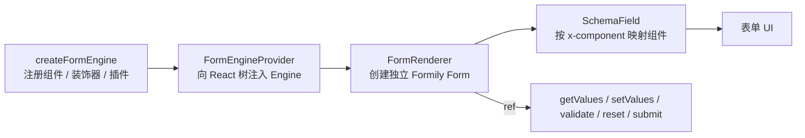

# 01. 快速开始：渲染第一张表单

> 状态：draft ｜ 最后更新：2026-11-09

**本章目标**：装好依赖，创建 Engine，渲染「员工入职登记」的第一版（姓名 + 部门），并能提交拿到值。预计 10–15 分钟。

## 1. 安装依赖

当前引擎发布到团队私有源，先在工程根目录的 `.npmrc` 中配置 scope：

```ini
@x-form-engine:registry=https://npm.bugduo.com/
```

> 如果私有源需要登录，请先按团队约定配置 token。

安装两个公开包：

```bash
pnpm add @x-form-engine/sdk @x-form-engine/components
```

> 以下以 pnpm 为例；使用 npm / yarn 时换成对应命令即可。

确认运行环境与发布线一致：

```bash
# 工程还不是这些版本时再执行
pnpm add react@17.0.2 react-dom@17.0.2 antd@4.22.8
```

Formily 2.3.7 由上述包作为依赖带入，不需要手动安装。

最后在应用入口引入一次 antd 样式（`main.tsx` / `index.tsx`）：

```ts
import 'antd/dist/antd.css';
```

> 当前版本线为 `0.0.1-beta`，支持 React 17 + antd 4；尚不支持 React 18 / antd 5。

## 2. 最小可运行表单

在 `App.tsx` 中写入以下完整代码：

```tsx
import React, { useEffect, useMemo, useRef, useState } from 'react';
import { Button, message } from 'antd';
import { basicComponents, basicDecorators } from '@x-form-engine/components';
import {
  createFormEngine,
  defaultFormattersPlugin,
  FormEngineProvider,
  FormRenderer,
} from '@x-form-engine/sdk';
import type { FormRendererInstance, FormSubmitResult } from '@x-form-engine/sdk';

const schema = {
  type: 'object',
  properties: {
    name: {
      type: 'string',
      title: '姓名',
      'x-decorator': 'FormItem',
      'x-component': 'Input',
      'x-component-props': { placeholder: '请输入姓名' },
      'x-validator': [{ required: true, message: '请输入姓名' }],
    },
    department: {
      type: 'string',
      title: '部门',
      'x-decorator': 'FormItem',
      'x-component': 'Select',
      enum: [
        { label: '研发部', value: 'rd' },
        { label: '产品部', value: 'product' },
        { label: '运营部', value: 'operation' },
      ],
      'x-component-props': { placeholder: '请选择部门' },
      'x-validator': [{ required: true, message: '请选择部门' }],
    },
  },
};

export default function App(): JSX.Element {
  // Engine 全应用创建一次；不要放在渲染路径里反复 new。
  const engine = useMemo(
    () =>
      createFormEngine({
        platform: 'pc',
        locale: 'zh-CN',
        components: basicComponents,
        decorators: basicDecorators,
        plugins: [defaultFormattersPlugin],
      }),
    []
  );

  // 组件卸载时释放插件与事件订阅。
  useEffect(() => () => engine.dispose(), [engine]);

  const formRef = useRef<FormRendererInstance>(null);
  const [values, setValues] = useState<FormSubmitResult['values'] | null>(null);

  const handleSubmit = async (): Promise<void> => {
    try {
      const result = await formRef.current!.submit();
      setValues(result.values);
    } catch {
      // 校验失败时 Formily 会 reject，且抛出的不是 Error 实例。
      message.error('请先补全必填项');
    }
  };

  return (
    <FormEngineProvider engine={engine}>
      <FormRenderer
        ref={formRef}
        schema={schema}
        schemaId="employee-onboarding"
        schemaVersion={1}
      />

      <Button type="primary" onClick={handleSubmit} style={{ marginTop: 16 }}>
        提交
      </Button>

      {values ? <pre>{JSON.stringify(values, null, 2)}</pre> : null}
    </FormEngineProvider>
  );
}
```

运行后应看到两个带标签的字段；不填直接提交，字段下方出现必填提示；填写完成后提交，页面下方打印：

```json
{
  "name": "张三",
  "department": "rd"
}
```

## 3. 代码拆解



| 代码 | 作用 |
|---|---|
| `createFormEngine({...})` | 创建 Engine。`components` 注册编辑组件，`decorators` 注册 `FormItem`，`plugins` 注册 Formatter 等服务。 |
| `FormEngineProvider` | 通过 React Context 把 Engine 传给子树；所有 `FormRenderer` 共享同一份 Registry。 |
| `FormRenderer` | 一个 `FormRenderer` 实例就是一个独立表单，内部创建自己的 Formily Form。 |
| `ref` | 拿到 `FormRendererInstance`，用于读值、写值、校验、重置、提交。 |
| `schema` | 表单结构。`properties` 的每个 key 就是最终 `values` 的 key。 |
| `x-decorator: 'FormItem'` | 使用 FormItem 包住字段，负责标签、必填星号与校验提示。 |
| `x-component` | 指定编辑组件；组件名必须在 Engine 中注册过。 |
| `x-validator` | 校验规则。上述写法要求字段必填。 |
| `schemaId` / `schemaVersion` | 标识这张表单的 schema 身份；提交时会写进快照，建议一开始就传。 |

> `defaultFormattersPlugin` 主要为后续的只读渲染准备，第一张表单不传也能渲染；现在注册可以避免以后加详情页时再改 Engine。

## 4. 常见坑

| 现象 | 原因 | 处理 |
|---|---|---|
| 字段没有标签、没有校验提示 | 忘了 `x-decorator: 'FormItem'` | 每个要展示标签的字段都加上 |
| 页面样式错乱 | 没引入 antd 样式 | 应用入口 `import 'antd/dist/antd.css'` |
| 每次输入都重建 Engine，表单闪烁/丢值 | Engine 创建写在组件渲染路径里 | 用 `useMemo`，并在卸载时 `dispose()` |
| 点击提交没反应 | `submit()` 校验失败被 `catch` | 检查必填项；`submit()` 失败会 reject |
| 提交值为空 | `x-component` 拼错或未注册 | 对照下一章的组件目录 |
| TypeScript 报 `FormRendererInstance` 不存在 | 从内部包或默认导出取类型 | 从 `@x-form-engine/sdk` 导入 |

## 5. 下一章

下一章会解释 `schema` 里每个键的含义，补齐员工登记表的日期与备注字段，并区分「渲染用的 Schema」和「后端保存的 Schema 文档」。

→ [`02-schema-basics.md`](02-schema-basics.md)
