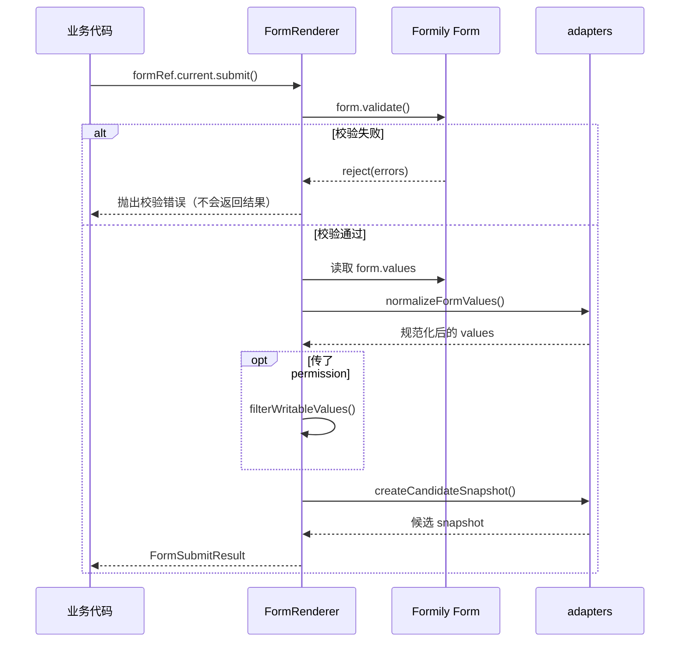

# 04. 提交、Value 与 Snapshot

> 状态：draft ｜ 最后更新：2026-11-09

**本章目标**：理解 `submit()` 做了什么，读懂 `FormSubmitResult` 里的 `values` 与 `snapshot`，并把它们正确交给业务后端保存。

## 1. `submit()` 做了什么



关键点：

1. **先校验**。校验不通过时直接 reject，不会返回半成品。
2. **返回普通对象**。`values` 和 `snapshot` 都是可序列化的普通对象，不包含 Formily 的响应式代理。
3. **不发 HTTP**。`submit()` 只负责“把表单变成可保存的数据”，业务后端由你调用。
4. **可能剔除字段**。如果给 `FormRenderer` 传了 `permission`，无写权限的字段会先从 `values` 中剔除，也不会进入快照。

## 2. `FormSubmitResult` 结构

```ts
interface FormSubmitResult {
  values: Record<string, unknown>;
  snapshot: FormSnapshot;
  schemaId?: string;
  schemaVersion?: number;
}
```

以员工登记表填写结果为例：

```ts
{
  schemaId: 'employee-onboarding',
  schemaVersion: 1,
  values: {
    name: '张三',
    department: 'rd',
    joinDate: '2026-11-01',
    probationMonths: 3,
    regularDate: '2027-02-01',
  },
  snapshot: {
    snapshotVersion: '1.0.0',
    schemaId: 'employee-onboarding',
    schemaVersion: 1,
    createdAt: '2026-11-09T02:30:00.000Z',
    locale: 'zh-CN',
    fields: {
      name: {
        path: 'name',
        fieldId: 'name',
        component: 'Input',
        componentVersion: '1.0.0',
        title: '姓名',
        value: '张三',
      },
      department: {
        path: 'department',
        fieldId: 'department',
        component: 'Select',
        componentVersion: '1.0.0',
        title: '部门',
        value: 'rd',
        displayValue: '研发部',
        options: [{ label: '研发部', value: 'rd' }],
      },
      // ...其余字段
    },
  },
}
```

### 2.1 `values`：稳定的业务值

- key 是字段路径（如 `name`、`contact.phone`），不是展示名；
- 值经过组件 Adapter 规范化；
- 适合入库、查询、审批流做业务判断。

### 2.2 `snapshot`：提交时刻的展示信息

| 字段 | 含义 |
|---|---|
| `snapshotVersion` | 快照协议版本，当前 `'1.0.0'` |
| `schemaId` / `schemaVersion` | 用的是哪一版 Schema；不传 props 时兜底为 `''` / `0` |
| `createdAt` | 快照生成时间（ISO 字符串） |
| `locale` | 生成时的语言环境 |
| `fields` | 以字段路径为 key 的字段快照表 |

每个字段快照包含：

| 字段 | 含义 |
|---|---|
| `path` | 字段路径，如 `department` |
| `fieldId` | 稳定字段身份，与下标路径分离 |
| `component` / `componentVersion` | 生成该值的组件及版本 |
| `title` | 提交时的字段标题 |
| `value` | 字段原始值 |
| `displayValue` | 展示值。Select 等枚举字段是选项 label |
| `options` | 命中选项的快照；**只保留与当前值匹配的选项**，不是完整选项表 |
| `metadata` | 附加信息，如 `{ displayMissing: true }` |
| `items` | 数组字段的行快照，带稳定 `itemId` |

`values` 回答“数据是什么”，`snapshot` 回答“当时用户看到的是什么”。两者都要保存，历史详情页才能在没有旧字典/旧组件的情况下忠实还原。

> 未填写字段和条件隐藏字段在 `values` 中没有实际值（JSON 序列化后通常不出现）；
> 快照 `fields` 仍可能保留该字段的元信息，但没有 `value`。读取快照时要按缺省处理。

## 3. 业务保存：提交后调用自己的 API

```tsx
import type { FormRendererInstance, FormSubmitResult } from '@x-form-engine/sdk';

const formRef = useRef<FormRendererInstance>(null);

const handleSubmit = async (): Promise<void> => {
  let result: FormSubmitResult;

  try {
    result = await formRef.current!.submit();
  } catch (validationError) {
    console.error('[employee-onboarding] 校验未通过', validationError);
    message.error('请先补全必填项');
    return;
  }

  try {
    await fetch('/api/employee-onboarding', {
      method: 'POST',
      headers: { 'Content-Type': 'application/json' },
      body: JSON.stringify({
        schemaId: result.schemaId,
        schemaVersion: result.schemaVersion,
        values: result.values,
        snapshot: result.snapshot,
      }),
    });
    message.success('提交成功');
  } catch (saveError) {
    console.error('[employee-onboarding] 保存失败', saveError);
    message.error('保存失败，请稍后重试');
  }
};
```

建议把“校验失败”和“保存失败”分开处理：前者是用户输入问题，后者是网络或服务端问题，提示语和重试策略不同。

## 4. 从后端文档加载 Schema

如果后端保存的是第 02 章介绍的 Schema 文档信封：

```ts
import { parseSchemaDocument } from '@x-form-engine/sdk';

// rawDocument 从接口获取
const doc = parseSchemaDocument(rawDocument);
```

然后渲染：

```tsx
<FormRenderer
  ref={formRef}
  schema={doc.schema}
  schemaId={doc.schemaId}
  schemaVersion={doc.version}
/>
```

注意：

- 文档信封的 `version` 对应渲染时的 `schemaVersion`；
- `parseSchemaDocument` 校验的是信封，不解释 `schema` 内部字段；
- 不传 `schemaId` / `schemaVersion` 时，快照里会是 `''` / `0`，历史还原会失去版本依据，**建议始终传**。

## 5. `onValuesChange`：实时拿值

需要做实时预览、草稿保存或跨字段提示时，用 `onValuesChange`：

```tsx
<FormRenderer
  ref={formRef}
  schema={doc.schema}
  schemaId={doc.schemaId}
  schemaVersion={doc.version}
  onValuesChange={(values) => {
    // values 是普通对象，可安全存入 state / localStorage
    setPreview(values);
  }}
/>
```

`onValuesChange` 在值变化时触发；它不替代 `submit()` 的校验与快照生成。

## 6. 常见坑

| 现象 | 原因 | 处理 |
|---|---|---|
| `submit()` 抛错，但拿不到 `error.message` | 校验失败 reject 的不是 `Error` | 拆分校验失败与保存失败；校验错误由 FormItem 展示 |
| 快照里 `schemaId` 为空、`schemaVersion` 为 0 | 没给 `FormRenderer` 传这两个 props | 渲染时就传入 |
| 快照里只有部分选项 | `options` 只保留命中项 | 需要完整选项表时从 Schema 取，不要依赖快照 |
| 后端收到的字段少了一个 | 传了 `permission`，该字段无写权限 | 检查权限信封；这是预期行为 |
| 把 `snapshot` 当权限/审计依据 | 快照是前端生成的候选数据 | 后端必须独立校验并生成权威快照 |
| 想直接拿 Formily 实例 | 公开 API 刻意不暴露 | 用 `getValues()` / `setValues()`；内部类型不承诺稳定 |

> Snapshot 是**前端候选快照**：展示信息可能来自前端字典或组件配置，不能作为权限、审计或最终展示的权威来源。
> 后端应校验 `values`，并按业务规则补全/冻结 Canonical Snapshot。

## 7. 本阶段 API 速查

| API | 签名 / 说明 |
|---|---|
| `createFormEngine(options?)` | `{ id?, platform?, locale?, debug?, components?, decorators?, plugins?, services? }` |
| `<FormEngineProvider engine>` | 注入 Engine；同一棵树内共享 Registry |
| `<FormRenderer />` | `schema`（必填）、`schemaId`、`schemaVersion`、`initialValues`、`scope`、`onValuesChange`、`disabled`、`readOnly`、`platform`、`locale`、`permission` |
| `FormRendererInstance` | `getValues()`、`setValues()`、`validate()`、`reset()`、`submit()`、`destroy()` |
| `FormSubmitResult` | `{ values, snapshot, schemaId?, schemaVersion? }` |
| `parseSchemaDocument(input)` | 校验并返回 `FormSchemaDocument`；非法输入抛 `SCHEMA_INVALID` |
| `validateEngineSchema(schema)` | 返回 `{ valid, errors, warnings }`；检查 `x-engine` 与引擎版本 |
| `basicComponents` | 七类 PC 编辑组件 |
| `basicDecorators` | `FormItem` 装饰器 |

完整的 API 参考（含只读、移动端、设计器、自定义组件）将在第 09 章补齐。

## 8. 下一章

到这里，第一张表单的闭环已经完成：渲染 → 校验 → 联动 → 提交 → 保存。

下一章（待编写）会介绍如何用 `ReadonlyRenderer` + 已保存的 `snapshot` 还原历史详情页，以及快照展示值的优先级规则。

→ [`05-readonly.md`](05-readonly.md)（占位）
