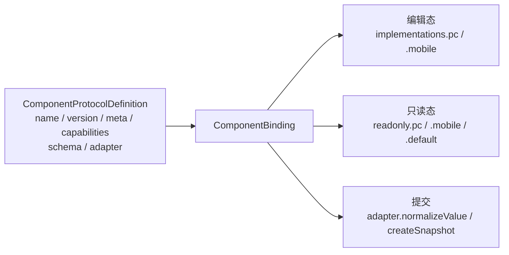

# 08. 自定义组件

> 状态：draft ｜ 最后更新：2026-11-10

**本章目标**：学会写一个自定义业务组件——定义它的协议、PC/移动端实现、只读实现与 Adapter，把它注册进 Engine，并理解它在提交时的 Value 规范化与快照生成中扮演什么角色。

读完本章，你应当能用同一份组件定义驱动「编辑态 + 只读态 + 提交快照」，而不是为每种形态各写一套代码。

## 1. 组件由「协议 + 实现 + Adapter」组成

一个组件在引擎里是一份 `ComponentBinding`，它把三块东西绑在一起：

| 组成 | 是什么 | 谁消费 |
|---|---|---|
| `protocol` | `ComponentProtocolDefinition`：名称、版本、能力、属性 Schema、Adapter | 注册校验、快照的 `component`/`componentVersion`、设计器物料 |
| `implementations` | 编辑态实现，按平台映射 `pc` / `mobile` | `FormRenderer`（编辑态） |
| `readonly` | 只读实现，按 `pc` / `mobile` / `default` 映射 | `ReadonlyRenderer` |
| `protocol.adapter` | Value 规范化与快照展示值生成 | `submit()` 的规范化与候选快照 |



自定义组件与内置的七类 P0 组件（`basicComponents`）走**完全相同**的注册与解析路径——`basicComponents` 本身就是一组 `ComponentBinding`，见 `packages/components/src/definitions/basic.ts`。所以本章的写法对任何业务组件都适用。

## 2. 组件协议 `ComponentProtocolDefinition`

```ts
interface ComponentProtocolDefinition {
  name: ComponentName;             // 即 string，组件唯一名，对应 schema 里的 x-component
  version: string;                 // 组件协议版本，写进快照的 componentVersion
  meta: ComponentMeta;             // 展示元数据：title / category / icon ...
  capabilities: ComponentCapabilities;
  schema: ComponentSchemaDefinition; // 组件自身 props 的 Schema 描述
  adapter?: ComponentAdapter;      // 可选：Value 规范化 / 快照生成
}
```

### 2.1 `meta`：给设计器与文档看的元数据

| 字段 | 说明 |
|---|---|
| `title` | 组件展示名，必填 |
| `category` | 分类，如 `basic` / `organization` |
| `icon` / `tags` / `description` | 可选展示信息 |
| `deprecated` | 标记已弃用，保留只读兼容 |

### 2.2 `capabilities`：声明能力（描述性元数据）

```ts
interface ComponentCapabilities {
  editable: boolean;
  readonly: boolean;
  mobile: boolean;
  datasource?: boolean;
  validation?: boolean;
  snapshot?: boolean;
  children?: boolean;
}
```

> **重要**：`capabilities` 目前是**声明性元数据，不参与运行时决策**。运行时判断「某平台是否有实现」看的是 `implementations` 与 `readonly` 映射里有没有对应键，而不是 `capabilities.mobile`。比如把 `mobile: true` 但 `implementations` 没给 `mobile`，移动端仍然会回退到 `pc` 并产生诊断。声明 `capabilities` 请保持与实现一致，避免误导设计器或阅读者。

### 2.3 `schema`：组件自身 props 的描述

`x-component-props` 会被 Formily 透传给组件，`schema` 描述这些 props 的结构（供设计器生成 Setter、校验）。基础组件只声明 `{ placeholder: { type: 'string' } }`，你可以按需声明更多：

```ts
schema: {
  type: 'object',
  properties: {
    multiple: { type: 'boolean', default: false },
    placeholder: { type: 'string' },
    options: { type: 'array' },
  },
}
```

## 3. 组件绑定 `ComponentBinding`

```ts
interface ComponentBinding<Impl = unknown, ReadonlyImpl = unknown> {
  protocol: ComponentProtocolDefinition;
  implementations: ComponentImplementations<Impl>;   // { pc?, mobile? }
  readonly?: ReadonlyImplementations<ReadonlyImpl>;  // { pc?, mobile?, default? }
}
```

平台解析规则：

- **编辑态**：优先当前平台（`pc` / `mobile`）的实现；缺失时回退到另一平台实现，并派发 `PlatformFallbackDiagnostic`（详见第 06 章）。
- **只读态**：按 `当前平台 → default → Formatter → Unknown 兜底` 解析（详见第 05 章）。

`ComponentBinding` 的泛型默认是 `unknown`，这是为了让协议保持 UI 无关；组件实现层把它收窄为 React 组件类型（`packages/components/src/types.ts` 里的 `ReactComponentBinding`）。业务代码写自定义组件时，直接用 `ComponentBinding` 并自己 `as` 收窄即可，不必引入内部包。

## 4. 完整示例：员工选择器

下面实现一个「员工选择器」：编辑态是一个 `Select`，业务值存稳定员工 ID；提交快照把 ID 展开成「姓名（部门）」；只读态优先展示快照里的展示值。完整代码见 [`examples/employee-onboarding/EmployeeSelector.tsx`](examples/employee-onboarding/EmployeeSelector.tsx)。

### 4.1 编辑态组件

自定义编辑组件遵循 Formily 字段组件约定：接收 `value`、`onChange`，用 `connect` 接入 Formily。`connect` 来自 `@formily/react`——这是**唯一**在写自定义组件时才需要的 Formily 依赖；七类 P0 组件已由引擎内置，业务代码用它们时无需碰 `@formily/react`。

```tsx
import { connect } from '@formily/react';
import { Select } from 'antd';

export interface EmployeeOption {
  label: string;
  value: string; // 员工 ID，稳定业务值
  dept?: string; // 部门，仅展示用
}

function EmployeeSelectorWidget(props: {
  value?: string | string[] | null;
  onChange?: (value: string | string[] | null) => void;
  options?: EmployeeOption[];
  multiple?: boolean;
  placeholder?: string;
}): JSX.Element {
  return (
    <Select
      mode={props.multiple ? 'multiple' : undefined}
      value={props.value ?? undefined}
      onChange={props.onChange}
      options={props.options}
      placeholder={props.placeholder}
      style={{ width: 320 }}
    />
  );
}

const EmployeeSelector = connect(EmployeeSelectorWidget);
```

### 4.2 只读组件

只读组件接收 `ReadonlyComponentProps`，**优先用 `snapshotValue`（快照冻结的展示值）**，无快照时降级到原始 `value`：

```tsx
import type { ReadonlyComponentProps } from '@x-form-engine/sdk';

function EmployeeSelectorReadonly(props: ReadonlyComponentProps): JSX.Element {
  const display = props.snapshotValue ?? props.value;
  return <span>{display == null ? '—' : String(display)}</span>;
}
```

### 4.3 Adapter

Adapter 是纯函数集合，把「表单里的值」和「提交/回显需要的值」解耦。当前运行时只接线了其中两个 hook：

- `normalizeValue(value, context)`：提交前把字段值归一为稳定业务值；
- `createSnapshot(value, context)`：生成候选快照的 `displayValue`。

```tsx
import type { ComponentAdapter } from '@x-form-engine/sdk';

type EmployeeValue = string | string[] | null;

const employeeSelectorAdapter: ComponentAdapter<EmployeeValue> = {
  normalizeValue(value, context) {
    if (value == null) return null;
    if (typeof value === 'string') return value;
    if (Array.isArray(value)) {
      return value.filter((item): item is string => typeof item === 'string');
    }
    // 可恢复的规范化告警：不阻断提交，进入 warnings
    context.warn?.('EMPLOYEE_VALUE_INVALID', `员工字段收到非字符串值，已忽略：${String(value)}`);
    return null;
  },

  createSnapshot(value, context) {
    if (value == null) return null;
    const options = readOptions(context.schema);
    const render = (id: string): string => {
      const found = options.find((option) => option.value === id);
      return found ? `${found.label}（${found.dept ?? '未填部门'}）` : id;
    };
    return Array.isArray(value) ? value.map(render) : render(value);
  },
};

function readOptions(schema: Record<string, unknown>): EmployeeOption[] {
  const props = schema['x-component-props'] as Record<string, unknown> | undefined;
  if (Array.isArray(props?.options)) return props.options as EmployeeOption[];
  if (Array.isArray(schema.enum)) return schema.enum as EmployeeOption[];
  return [];
}
```

两个 context 的形态：

- `normalizeValue` 的 context 有 `schema / path / locale / warn / error`；`warn` 产生可恢复告警，`error` 或抛错产生阻断提交的错误。
- `createSnapshot` 的 context 只有 `schema / path / locale`——它能从 Schema 的 `options` / `enum` 解析展示值，但**拿不到编辑期缓存的展示信息**，也**不该发起网络请求**。需要权威展示值时交给后端在 Canonical Snapshot 里补全（见第 04 章）。

> `serializeValue` 与 `restoreSnapshot` 已在类型中声明，但当前提交/只读链路尚未接线，暂不在业务里依赖它们。

### 4.4 组装协议与绑定

```tsx
import type { ComponentBinding, ComponentProtocolDefinition } from '@x-form-engine/sdk';

const employeeSelectorProtocol: ComponentProtocolDefinition = {
  name: 'EmployeeSelector',
  version: '1.0.0',
  meta: { title: '员工选择', category: 'organization' },
  capabilities: {
    editable: true,
    readonly: true,
    mobile: false, // 暂只有 PC 实现；移动端会回退 PC 并诊断
    datasource: true,
    snapshot: true,
  },
  schema: {
    type: 'object',
    properties: {
      multiple: { type: 'boolean', default: false },
      placeholder: { type: 'string' },
      options: { type: 'array' },
    },
  },
  adapter: employeeSelectorAdapter,
};

export const employeeSelectorBinding: ComponentBinding = {
  protocol: employeeSelectorProtocol,
  implementations: { pc: EmployeeSelector },
  readonly: { default: EmployeeSelectorReadonly },
};
```

### 4.5 注册进 Engine

把绑定追加到 `components` 数组即可，与内置组件同源：

```tsx
import { basicComponents, basicDecorators } from '@x-form-engine/components';
import { createFormEngine } from '@x-form-engine/sdk';
import { employeeSelectorBinding } from './EmployeeSelector';

const engine = createFormEngine({
  platform: 'pc',
  locale: 'zh-CN',
  components: [...basicComponents, employeeSelectorBinding],
  decorators: basicDecorators,
});
```

Schema 里即可引用它：

```json
{
  "type": "string",
  "title": "直属主管",
  "x-component": "EmployeeSelector",
  "x-component-props": {
    "placeholder": "请选择主管",
    "options": [
      { "label": "张三", "value": "u_10001", "dept": "研发部" },
      { "label": "李四", "value": "u_10002", "dept": "产品部" }
    ]
  },
  "x-validator": [{ "required": true, "message": "请选择主管" }]
}
```

多选时字段类型要与组件值结构一致，用 `type: "array"` + `multiple: true`，不要只靠 `multiple` 推断数据类型（见 `docs/tech-design/02-specs/02-component-spec.md`）。

## 5. 组件在提交中的角色

`submit()` 已经替你跑完规范化与快照（见第 04 章时序图），自定义组件不需要自己处理：

1. **Value 规范化**：`normalizeFormValues` 遍历 Schema，命中叶字段时调 `binding.protocol.adapter.normalizeValue`。没有 adapter 的字段（基础 primitive）原样透传。
2. **候选快照**：`createCandidateSnapshot` 对每个叶字段调 `binding.protocol.adapter.createSnapshot`，返回值写入该字段的 `displayValue`；同时把 `binding.protocol.version` 写进 `componentVersion`。

于是员工选择器提交后，快照里的字段长这样：

```json
{
  "path": "directSupervisor",
  "fieldId": "directSupervisor",
  "component": "EmployeeSelector",
  "componentVersion": "1.0.0",
  "title": "直属主管",
  "value": "u_10001",
  "displayValue": "张三（研发部）"
}
```

- `value` 是稳定业务值（ID），入库用；
- `displayValue` 是提交时刻用户看到的展示，历史回显用；
- `componentVersion` 是生成该值的组件协议版本，供未来组件升级时做版本化迁移。

## 6. 注册与冲突规则

组件注册是**严格命名空间 + 严格冲突**：

- **同名即冲突**：两个绑定用同一个 `protocol.name` 注册时，第二个会抛 `PLUGIN_CONFLICT`，**没有隐式「后注册覆盖先注册」**。这是刻意设计，避免两个物料静默互相覆盖。
- **组件与装饰器分命名空间**：`x-component` 走 `registry.components`，`x-decorator` 走 `registry.decorators`，同名不互相冲突（如组件 `FormItem` 与装饰器 `FormItem` 可以并存）。
- **暂无覆盖机制**：当前实现没有「显式 trusted 声明覆盖」的 API。想替换某个内置组件，做法是给它起一个**新的唯一名字**，或通过插件注册新名字，而不是重复注册同名覆盖。

组件名一经发布不随意更改；破坏性 Value 变更应升级 `version` 并提供迁移器（组件版本与 Schema 版本是两条独立的轴，见 `docs/tech-design/form-engine-architecture-design.md`）。

## 7. 平台实现与只读渲染

- `implementations.pc` / `implementations.mobile` 是编辑态的平台真相；缺 `mobile` 时移动端回退 `pc` 并派发诊断，出口是 `onDiagnostic`、`component:platform-fallback` 事件或 `debug: true` 控制台告警（详见第 06 章）。
- `readonly.pc` / `readonly.mobile` / `readonly.default` 是只读态的平台真相；`ReadonlyRenderer` 不创建编辑态 Form，只读组件不应发起编辑态搜索请求（详见第 05 章）。
- 只读展示的优先级是：快照 `displayValue`（即 `snapshotValue`）→ 组件快照元数据 → 静态 Schema 规则 → 允许的兼容查找 → 原始值 + 诊断。因此只读组件应优先渲染 `snapshotValue`。

## 8. 常见坑

| 现象 | 原因 | 处理 |
|---|---|---|
| 注册两个同名组件，引擎直接抛错 | 注册严格冲突，无隐式覆盖 | 给新组件起唯一名字；同名替换当前不支持 |
| 改了 `capabilities.mobile` 但移动端行为没变 | `capabilities` 是描述性元数据，不参与运行时决策 | 真正决定回退的是 `implementations` 里有没有 `mobile` |
| 快照里 `displayValue` 是 undefined | 组件没配 `adapter.createSnapshot`，或返回了 `undefined` | 给组件加 adapter；需要展示值就返回非 `undefined` 的值 |
| `createSnapshot` 里想发请求查展示名 | 候选快照不发起网络请求 | 从 Schema `options`/`enum` 解析，或交给后端补全 Canonical Snapshot |
| 提交值多了奇怪的类型 | 没写 `normalizeValue`，原始值透传 | 用 `normalizeValue` 把值收敛到稳定业务类型 |
| 自定义组件接不上字段 | 忘了 `connect` 或没处理 `value`/`onChange` | 用 `@formily/react` 的 `connect` 包裹，按字段组件约定实现 |
| 只读组件显示成 ID | 只读了 `value`，没优先用 `snapshotValue` | 优先渲染 `props.snapshotValue ?? props.value` |

## 9. 下一章

到这里，你已经能写自定义组件并让它贯穿编辑、提交、只读三条链路。下一章汇总全部公开 API 的速查表。

→ [`09-api-reference.md`](09-api-reference.md)（占位）
