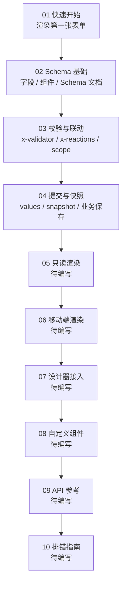

# x-form-engine 业务接入指南

> 状态：draft（第 1–4、6 章已完成，第 5、7–10 章待编写）｜ 最后更新：2026-11-10

本指南面向**第一次使用 x-form-engine 的业务开发者**。读完后，你应该能在一个 React 后台里独立接入第一张可校验、可提交的表单，并知道提交结果里的 `values` 与 `snapshot` 分别是什么、该怎么保存。

如果你只想先跑起来，直接看 [`01-quickstart.md`](01-quickstart.md)。

## 读者与前置要求

| 项 | 要求 |
|---|---|
| 前端基础 | 会用 React 函数组件与 Hooks |
| 运行环境 | React 17.0.2、react-dom 17.0.2、antd 4.22.8 |
| 构建工具 | Vite / Webpack 等常规 React 工程即可 |
| 依赖认知 | 不需要了解 Formily 内部机制；Schema 的 `x-*` 键会在指南中解释 |
| 包来源 | 私有 npm 源 `https://npm.bugduo.com/`，当前版本线 `0.0.1-beta` |

> 当前引擎锁定 React 17 + antd 4 + Formily 2.3.7，尚未支持 React 18 / antd 5。
> 已实现的公开接口以 `packages/types` 与 `packages/sdk` 源码为准；本指南只解释用法，不重复定义类型。

## 学习路径



## 章节与状态

| 章 | 主题 | 状态 |
|---|---|---|
| [`01-quickstart.md`](01-quickstart.md) | 安装、初始化 Engine、渲染并提交第一张表单 | ✅ 已完成 |
| [`02-schema-basics.md`](02-schema-basics.md) | Schema 结构、字段类型、组件目录、Schema 文档信封 | ✅ 已完成 |
| [`03-validation-and-linkage.md`](03-validation-and-linkage.md) | 校验、条件显隐、派生值、初始值与实例 API | ✅ 已完成 |
| [`04-submit-and-snapshot.md`](04-submit-and-snapshot.md) | `submit()` 语义、Value / Snapshot、业务保存 | ✅ 已完成 |
| [`05-readonly.md`](05-readonly.md) | 只读渲染与历史回显 | ⬜ 待编写 |
| [`06-mobile.md`](06-mobile.md) | 移动端物料入口、七类 P0 组件、平台回退诊断 | ✅ 已完成 |
| [`07-designer.md`](07-designer.md) | 设计器导出 Schema 的业务渲染 | ⬜ 待编写 |
| [`08-custom-components.md`](08-custom-components.md) | 组件协议与自定义组件注册 | ⬜ 待编写 |
| [`09-api-reference.md`](09-api-reference.md) | 公开 API 速查 | ⬜ 待编写 |
| [`10-troubleshooting.md`](10-troubleshooting.md) | 常见报错与排查路径 | ⬜ 待编写 |

## 贯穿示例

全文使用同一张「员工入职登记」表单，随章节逐步长大：

| 章节 | 示例能力 |
|---|---|
| 01 | 姓名、部门、提交 |
| 02 | 补齐入职日期、备注，认识组件目录 |
| 03 | 条件部门说明、试用期与预计转正日期、编辑回填 |
| 04 | 提交后拿到 `values` + 候选快照并保存 |
| 06 | 同一 Schema 的移动端渲染，PC 专用组件的回退诊断 |

完整代码在 [`examples/employee-onboarding/`](examples/employee-onboarding/)，可直接复制进业务工程。
仓库内的 `apps/playground` 渲染了同一张表，可作为可运行参考：

```bash
pnpm --filter playground dev
```

## 本阶段可用的公开 API

第 1–4 章覆盖的 API 都在 `@x-form-engine/sdk` / `@x-form-engine/components` 两个公开包内：

| API | 来源 | 用途 | 章节 |
|---|---|---|---|
| `createFormEngine(options)` | `sdk` | 创建 Engine，注册组件、装饰器、插件、服务 | 01 |
| `FormEngineProvider` | `sdk` | 把 Engine 注入 React 树 | 01 |
| `FormRenderer` | `sdk` | 按 Schema 渲染表单，持有 Formily Form | 01 |
| `FormRendererInstance` | `sdk` | `getValues / setValues / validate / reset / submit` | 01、03、04 |
| `FormSubmitResult` | `sdk` | `values`、`snapshot`、`schemaId`、`schemaVersion` | 04 |
| `parseSchemaDocument` | `sdk` | 校验并解析后端 Schema 文档信封 | 02、04 |
| `validateEngineSchema` | `sdk` | 校验 Schema 中的 `x-engine` 扩展与版本 | 02 |
| `basicComponents` | `components` | PC 基础编辑组件 | 01、02 |
| `basicDecorators` | `components` | PC 基础装饰器（FormItem） | 01、02 |
| `defaultFormattersPlugin` | `sdk` | 注册默认 Formatter（主要供只读渲染） | 01 |

## 阅读约定

- **只依赖公开包**：业务代码只从 `@x-form-engine/sdk` 与 `@x-form-engine/components` 导入，不直接引用 `core` / `renderer` / `formily` 等内部包。
- **字段名即业务值 key**：示例用英文键（`name` / `department`），中文展示名放 `title`。
- **代码自包含**：每章示例可单独复制运行，不依赖前一章省略的片段。
- **`x-*` 键的含义**：`x-decorator`、`x-component`、`x-component-props`、`x-validator`、`x-reactions` 都是 Schema 配置键，不是额外的 SDK 接口。
