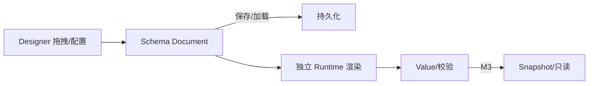
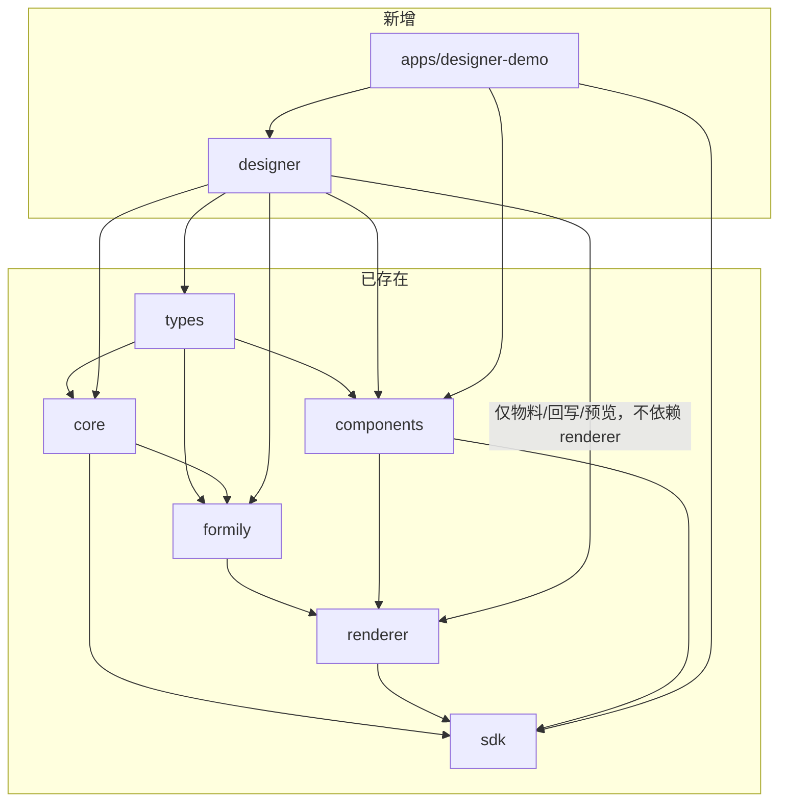

# M2「Designer 闭环」设计文档

> 状态：待评审
> 日期：2026-11-08
> 范围：`mvp-roadmap.md` §6 的 M2（Designer 闭环，M2-01 ~ M2-09）
> 关联：`mvp-roadmap.md`、`02-specs/07-designer-adapter.md`、`verification/04-designable.md`、`adr/0001-antd5-upgrade-path.md`、`AGENTS.md`

---

## 1. 意图与动机

M1 已交付引擎内核（`types`/`core`/`formily`/`renderer`/`components`/`sdk` + `playground`），可以「用 Schema 渲染表单」。但 Schema 目前只能手写，缺少可视化产出的入口。M2 的目标是补上这条链的前半段——**设计器**，让业务方通过拖拽和属性配置产出 Runtime 可直接消费的 Schema，从而闭环：

成功标准即 roadmap M2 验收的 5 条：

1. 可以拖拽创建表单；
2. 可以配置字段基础属性；
3. 可以保存并重新打开；
4. 可以通过独立 Runtime 渲染设计器产出的 Schema；
5. 设计器预览与 Runtime 结果一致。

## 2. 目标 / 非目标 / 反目标

### 2.1 目标

- 新建 `packages/designer`：把引擎组件定义（`ComponentBinding`）映射为 Designable 物料（Behavior/Resource）、节点与 Setter，并封装 Schema 双向回写、保存/加载、版本标识与预览。
- 新建 `apps/designer-demo`：一个可运行的 Designable 完整 Workbench（物料面板 + 画布 + 组件树 + 属性面板 + 真实拖拽），用于端到端验收。
- 打通「拖拽建表单 → 配属性 → 保存重开 → 导出 Schema → 独立 Runtime 渲染」并证明所见即所得。

### 2.2 非目标（本期不做）

- 移动端设计器、移动端物料（`mobile` 能力保留契约，不实现）。
- 异步 Plugin、动态远程插件加载（M2/FUT-03）。
- 高级 Setter（含 Monaco 的 `ReactionsSetter`、复杂数据源/校验表达式编辑，FUT-16）。
- 设计器内的业务 HTTP 提交、真实 Snapshot 生成（M3）。
- antd 5 / React 18 升级（ADR-0001 明确：升级 = 重写设计器）。
- 表单级属性（Form 根节点的 layout/labelAlign 等）：本期不持久化，设计器隐藏 Form 根节点设置面板（Q6 已定 A）。

### 2.3 反目标（做出来就算失败）

- 把 Designable 类型泄漏进公共 `@x-form-engine/types` 或 `@x-form-engine/sdk`。
- 让 `designer` 反向依赖 `renderer`，或让运行时依赖 `@designable/*`（BLOCK-06）。
- 设计器内部生成一份与运行时组件定义「漂移」的物料副本（必须由同一 `ComponentBinding` 派生）。
- 把 Designable 的 `x-designable-id` 当成业务稳定键参与 Value/Snapshot 语义。

## 3. 约束（不可违反）

1. 依赖方向单向：`types` 不依赖任何 UI 库；`designer` 不依赖 `renderer`；`formily/adapter` 不依赖 Designable；运行时（renderer/sdk）不依赖 Designable。
2. `x-engine` 是唯一引擎扩展命名空间；设计器保存前必须经过 `validateEngineSchema` 校验，未知 `x-engine` 键只告警不丢弃。
3. 组件身份统一：设计器物料、预览实现、运行时实现都来自同一个 `FormComponentDefinition`（此处为 `packages/components` 的 `ReactComponentBinding`）。
4. 版本轴分离：业务 `schemaVersion`（信封 `version`）与 `engineSchemaVersion` 是两条独立版本轴；设计器只写它该写的，不擅自改历史业务实例的 Schema。
5. 公共 API 稳定：业务项目只依赖 `@x-form-engine/sdk` 与 `@x-form-engine/components`，不依赖 `designer`。

## 4. 已确定的决策

- **技术栈**：沿用已验证基线 `React 17.0.2 + antd 4.22.8 + @formily/* 2.3.7 + @designable/* 1.0.0-beta.45`（`verification/01-version-lock.md` 已锁定可安装、可 typecheck、可运行）。
- **设计器形态**：Designable 1.x 完整 Workbench（物料面板 + 画布 + 组件树 + 属性面板 + 真实拖拽），按 M2-01~09 逐项验收（用户已确认，不切薄）。
- **设计器定位**：ADR-0001 定性为「临时资产」——Designable 1.x 是当前可行性依赖，antd5 升级时整体重写。因此本设计不追求长期生产级打磨，但必须把「定义 → 物料 → Schema → Runtime 渲染」这条数据链做对、可验证。
- **隔离**：设计器作为独立包 + 独立应用，绝不进入运行时主包。

## 5. 架构设计

### 5.1 包结构与依赖方向

> 说明：`designer` 依赖 `core`（`createFormEngine`、`parseSchemaDocument`、`validateEngineSchema`）、`formily`（`createEngineSchemaField`）、`components`（`basicComponents`）、`types`，**不依赖 `renderer`**。预览复用 `formily` 的编译产物，而非 Renderer 的 React 入口（ADR-0001 §3、spec 07 §7）。

### 5.2 `packages/designer` 模块划分

| 模块 | 职责 | 关键依赖 |
|---|---|---|
| `materials.ts` | 把 `ReactComponentBinding[]` 派生为「宿主组件 map」（`.Behavior`/`.Resource` 挂载在组件实现上） | `@designable/core` 的 `createBehavior`/`createResource` |
| `schema-io.ts` | Schema ↔ TreeNode 双向回写；导出/导入信封（`FormSchemaDocument`）与校验 | `@designable/formily-transformer`、`@x-form-engine/core` |
| `designer.ts` | 设计器启动引导：`createDesigner` → `ensureWorkspace` → `registerDesignerBehaviors` → `setCurrentTree` 的正确顺序 | `@designable/core` |
| `setters.ts` | 基础 Setter 目录（name/title/description/required/placeholder/options 等），用 `@designable/react-settings-form` 的 `SettingsForm` 承载 | `@designable/formily-setters` + `@designable/react-settings-form` |
| `preview.tsx` | `DesignerPreview`：用 `createForm` + `createEngineSchemaField` 渲染当前 Schema | `@formily/core`、`@x-form-engine/formily`、`@x-form-engine/components` |
| `index.ts` | 公共导出，不泄漏 Designable 内部类型 |

### 5.3 物料派生（spec 07 §3/§4）

`materials.ts` 的公共契约是**宿主组件 map**：对每个 `ReactComponentBinding`，把 `.Behavior`/`.Resource` 挂载到组件实现上（沿用上游 `Input.Behavior = createBehavior(...)` / `Input.Resource = createResource(...)` 惯例），返回 `Record<name, 宿主组件>`。同一份 map 同时喂给 `ResourceWidget.sources` 与 `ComponentTreeWidget.components`——因为 `@designable/react` 的 `ComponentTreeWidget` 挂载时会用 `components` prop 重新执行 `registerDesignerBehaviors`（整体替换 store），「裸数组 + 显式注册」的顺序会在画布挂载时被覆盖，导致物料面板有物料、画布却匹配不到 Behavior。

- **Behavior**：`name = protocol.name`，`extends: ['Field']`，`selector: node.props['x-component'] === name`，`designerLocales` 取 `protocol.meta.title/category`。
- **propsSchema（字段级与组件属性分层）**：字段级基础属性（`name`/`title`/`description`/`required`）位于顶层，组件自有属性（`protocol.schema.properties` 的 `placeholder`/`options`）挂到 `x-component-props`。否则 `placeholder`/`options` 会写到节点顶层，运行时组件收不到，WYSIWYG（M2-09）不成立。**手工构造这份 propsSchema，不调用 `createFieldSchema`**——已核验 `createFieldSchema` 会硬引用 `ReactionsSetter`（Monaco，FUT-16 延后），且其 `enum`/`x-reactions`/`x-validator` 字段超出本期「基础属性」范围。
- **Resource**：`title = protocol.meta.title`，`icon` 用占位图标（本期不引入图标集），`elements: [{ componentName: 'Field', props: { type: 'string', title, 'x-decorator': 'FormItem', 'x-component': name, ...默认属性 } }]`。
- **字段 `name`**：Value 的 key，必填。拖入时自动生成唯一默认名（`field_1`/`field_2`…），可在属性面板编辑；导出时重名校验失败即拒绝（`transformToSchema` 会对同名 key 静默覆盖，属于数据丢失）。
- 基础 `Field` 行为与 `FormItem` 装饰器行为来自 `@designable/formily-antd`，作为宿主一并纳入 map，否则 `componentName: 'Field'` 与 `x-decorator: 'FormItem'` 无法解析。

### 5.4 Schema 双向回写与信封（M2-04/05/06/07）

- 回写用 `transformToSchema(tree)` / `transformToTreeNode({ schema })`（已验证保持 `x-designable-id`，回写补 `x-index`）。
- 设计器保存的是完整信封 `FormSchemaDocument { schemaId, version, engineSchemaVersion, formilyVersion?, schema, createdAt?, updatedAt? }`。
- 导出前：`validateEngineSchema(schema)` 通过（无 error）才允许产出；导入前：`parseSchemaDocument(doc)` 校验信封。
- `version` 为业务 `schemaVersion`（保存自增）；`engineSchemaVersion` 固定写 `ENGINE_SCHEMA_VERSION`。二者不混用。
- `x-designable-id`/`x-index` 原样保留在 Schema 中，渲染器编译时忽略（已是现状），迁移时不当作业务键。
- 导入时 `engineSchemaVersion !== ENGINE_SCHEMA_VERSION` → **拒绝导入并给出明确错误**（fail-closed，与 `validateEngineSchema` 已把不支持版本视为 error 一致）；只读打开 + 迁移提示留待 Schema Migration（FUT-04）。不改 `parseSchemaDocument`/`validateEngineSchema` 的公共边界。

### 5.5 预览（M2-08）

`DesignerPreview` 不依赖 `@x-form-engine/renderer`，而是：

- `createEngineSchemaField` 来自 `@x-form-engine/formily`，与 Renderer 走同一条 Schema 编译路径，因此「同一份组件实现 + 同一份编译产物」保证 WYSIWYG。
- 预览只读/可编辑由 `mode` 控制；预览不做真实提交。
- 预览形态：Workbench 内的**实时预览**——`DesignerPreview` 订阅当前节点树变化并增量刷新（spec 07 §7）；在 `designer-demo` 中作为 Viewport 的「设计/预览」切换。

### 5.6 `apps/designer-demo`

- 用 `@designable/react` 的 `Designer`/`Workbench`/`StudioPanel` 组装四块面板：`ResourceWidget`（物料）、`ViewportPanel`（画布）、`OutlineTreeWidget`（组件树）、`SettingsPanel`（属性面板），配 `HistoryWidget` 撤销重做。
- Viewport 提供「设计/预览」切换，预览走 `DesignerPreview`。
- Form 根节点设置面板隐藏（Q6 = A：表单级属性本期不持久化），避免「能改但存不下来」的假能力。
- 保存/加载用 `localStorage`（演示用，传输无关；业务持久化留待接入方）。
- 「独立 Runtime 渲染」（M2-09）的验证放在 `apps/playground`（无任何 Designable 依赖）用 `@x-form-engine/sdk` 渲染导出 Schema，避免在设计器应用里把 Runtime 与 Designable 打进同一构建；辅以静态 import 守卫测试（`designer` 不 import `renderer`，`renderer`/`sdk` 不 import `@designable`）。
- 构建沿用 playground 的 Vite 配方：`@vitejs/plugin-react` + `resolve.alias /^~/ -> ''` + `less.javascriptEnabled`。设计器依赖的 `.less` 由浏览器构建链路处理（不进入 Node 侧）。

## 6. 验收标准（M2-01 ~ M2-09）

| 编号 | 任务 | 验收 |
|---|---|---|
| M2-01 | Designable Adapter | `materials.ts` 能从 `basicComponents` 派生 7 个物料的 Behavior/Resource，且注册后可匹配 |
| M2-02 | 基础物料面板 | 物料面板列出 7 个基础组件，可拖入画布 |
| M2-03 | 基础属性配置面板 | 选中节点可编辑 title/placeholder/options/required/description，回写节点 props |
| M2-04 | Schema 导出 | `transformToSchema` 产出经 `validateEngineSchema` 通过的 Schema |
| M2-05 | Schema 导入 | `parseSchemaDocument` + `transformToTreeNode` 还原节点树，二次往返复用 `x-designable-id` |
| M2-06 | 保存/加载 | 保存到 localStorage、重开还原节点树 |
| M2-07 | 版本标识 | 信封含 `version`（自增）与 `engineSchemaVersion`，导入时校验版本 |
| M2-08 | 设计器预览 | `DesignerPreview` 按当前 Schema 渲染出字段 |
| M2-09 | Designer/Runtime 解耦 | 用 `@x-form-engine/sdk`（不依赖 designer）渲染导出 Schema 与预览一致；静态检查 `designer` 不 import `renderer`、`renderer`/`sdk` 不 import `@designable` |

组件范围：本期物料 = M1 已实现的 7 个基础组件（Input/Textarea/Number/Select/Radio/Checkbox/DatePicker）。Array/Upload/UserSelect 等 M1 未实现，不在本期物料内。

## 7. 留给实现者的自由（我的决定，可被推翻）

1. 包布局固定为 `packages/designer` + `apps/designer-demo` 两个新工作区。
2. 物料图标用占位 icon，不引入图标集。
3. `apps/designer-demo` 的保存/加载用 `localStorage`。
4. 基础 Setter 覆盖：name、title、description、required、placeholder、options；`format`/校验表达式、Monaco 相关 Setter 延后。
5. 平台配置编辑（spec 07 §6 的 `x-engine.platform` 白名单）本期不实现，保留扩展位。
6. 字段级/组件属性分层（`x-component-props`）、宿主组件 map 注册载体、字段 `name` 自动唯一命名 + 导出重名校验、版本不匹配 fail-closed 拒绝、Workbench 内实时预览——均为本次评审后新增的实现决定（对应 reviewer 的 Q1~Q5）。
7. **Q6 已定（A）**：表单级属性本期不持久化，`FormSchemaDocument` 保持冻结；设计器隐藏 Form 根节点设置面板。

## 8. 风险

| 风险 | 缓解 |
|---|---|
| Designable 维护停滞（2022-02-28 后无版本） | ADR-0001 已定性临时资产；核心机制已验证；只做浏览器侧，不进入运行时 |
| 完整 Workbench UI / 真实拖拽未经 E2E 验证 | 用 `designer-demo` 手动跑通 + 关键机制单测；拖拽是 Designable 原生能力，风险在配置细节 |
| `@designable/formily-antd` 的 `Field`/`FormItem` 行为与我们的组件名冲突 | 以「组件 Definition 单一来源」为准，我们的物料用 `x-component` 匹配；`FormItem` 仅作装饰器，冲突点列为实施首个 spike |
| Setter 上下文耦合（需 Formily Field / Designable Context） | 基础 Setter 挂载在 `SettingsPanel` 标准上下文内；自建 Setter 遵循受控 `value/onChange` 协议 |

## 9. 评审收敛结论

**Q6 · 表单级属性是否本期持久化 → 已定 A**：本期不持久化，`FormSchemaDocument` 保持冻结，设计器隐藏 Form 根节点设置面板。
