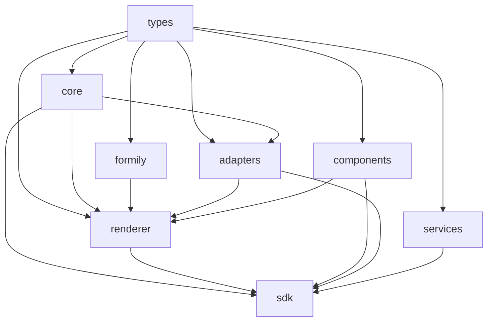

# M3「Value / Snapshot / Readonly 闭环」设计文档

> 状态：待评审
> 日期：2026-11-08
> 范围：`mvp-roadmap.md` §6 的 M3（M3-01 ~ M3-13）
> 关联：`mvp-roadmap.md`（BLOCK-01~05）、`02-specs/08-readonly-renderer.md`、`02-specs/09-value-snapshot.md`、`verification/06~08`、`AGENTS.md`

---

## 1. 意图与动机

M1 交付了引擎内核（用 Schema 渲染/校验/取值），M2 交付了设计器闭环（可视化产出 Schema）。但「填写 → 提交 → 历史还原」这条链还断着：`submit()` 只返回占位快照，没有 Value 规范化，没有只读渲染器，没有权限收敛，没有版本迁移。M3 补齐这条链的**后半段**：


成功标准即 roadmap M3 验收 6 条：

1. 提交记录同时保存 Value 和 Canonical Snapshot；
2. 可以读取历史记录；
3. 可以正确还原字段标题和展示值；
4. 当前 Schema 修改不影响历史记录；
5. 缺少组件时能够降级展示；
6. 未授权用户无法读取受保护的数据。

## 2. 目标 / 非目标 / 反目标

### 2.1 目标

- 扩展 `packages/types`：Value 协议（`NormalizeResult`）、稳定字段身份（`fieldId`/`itemId`）、Permission 协议（fail-closed）、Migration 协议（四版本轴 + 有序迁移链）、Readonly 组件契约、Formatter 契约、I18n 契约。
- 新建 `packages/adapters`：Value 规范化 + Candidate Snapshot 生成（纯逻辑，UI 无关）。
- 新建 `packages/services`：权限解析器、默认 Formatter、I18n、静态 Datasource（均纯逻辑，可注入 EngineServices）。
- 扩展 `packages/core`：生产级 Migration Registry、字段身份工具。
- 扩展 `packages/renderer`：独立只读渲染器（PC + 基础移动兜底）、`submit()` 接入规范化 + Candidate Snapshot + 权限收敛。
- 扩展 `packages/components`：7 个基础组件的只读实现 + 默认只读兜底 + Unknown 兜底。
- 扩展 `packages/sdk`：对外暴露新公共 API。
- 扩展 `apps/playground`：历史只读展示 Demo（出差申请场景）。

### 2.2 非目标（本期不做）

- 完整 Mobile 编辑态渲染器（FUT-01/02，不在 M3-01~13 内）。只读渲染器接受 `platform: 'pc' | 'mobile'`，移动端用同一套只读逻辑 + 基础响应式布局兜底，不建专用移动只读组件。
- 后端实现：Canonical Snapshot 生成、权限服务、字典/组织服务、提交 API。M3 只定义**协议 + 传输无关的前端实现 + 内存 Demo**（`submit()` 仍是 transport-free）。
- 完整业务组件（UserSelect/DeptSelect/DictSelect/Upload）的 React 实现。只提供其 Value/Snapshot 规范化与 Formatter 的**参考实现**以证明协议可扩展。
- 复杂权限表达式、组织树 DSL、可视化权限设计器（BLOCK-01 暂不实现项）。
- 异步 Plugin、动态远程插件加载（FUT-03）。
- 虚拟滚动 / 大表单专项性能优化（FUT-11/12）。

### 2.3 反目标（做出来就算失败）

- 把只读渲染做成 `disabled={true}`，或创建 Formily Form 跑编辑态 Reactions/Effects。
- 只读渲染器默认访问实时数据源（应优先 Snapshot，只有显式允许才做兼容查询）。
- 把前端 `displayValue` 当作权威身份信息；把 `x-engine.permission` 当作授权凭证。
- 把 Snapshot 与 Value 合并，或把权限写入 Snapshot。
- 用数组下标作为历史重复行的唯一身份。
- 迁移覆盖原始历史 Snapshot。
- 破坏 `types` 无 React/Formily/Designable 依赖、业务只依赖 `sdk` + `components` 的边界。

## 3. 约束（不可违反）

1. 依赖方向单向：`types` 无任何 UI 依赖；`core` 不依赖 React；`adapters`/`services` 不依赖 React 与 Formily；`renderer` 不依赖 Ant Design 与 Designable；`components` 依赖 `types` + Formily/antd（React 实现边界）；`sdk` 聚合公共 API。
2. `submit()` 保持 transport-free：只返回 `{ values, snapshot, schemaId, schemaVersion }`，不做业务 HTTP。
3. 权限 fail-closed：无权限上下文默认拒绝；Schema 权限提示只能收紧、不能提权；提交前剔除无写权限字段。前端权限仅 UX，后端独立强制。
4. 版本轴分离：`schemaVersion` / `engineSchemaVersion` / `snapshotVersion` / `componentVersion` 互不混用；迁移有序、非破坏、版本检测在读时进行。
5. 组件身份统一：同一个 `ComponentBinding` 同时驱动编辑态、设计器物料与只读渲染；只读实现挂在该 binding 的 `readonly` 字段上。

## 4. 已确定的决策

- **M3 范围 = roadmap M3-01~13**（Value/Snapshot/Readonly 闭环），不含 M4 工程化发布，不含 Mobile 编辑态渲染器。
- **权限协议**沿用 `verification/07`：`PermissionEnvelope { version, form:{read,submit}, fields:Record<path,{read,write}> }`，前端有效权限 = 信封 ∩ Schema 提示，未声明字段默认拒绝。
- **Snapshot 双态**沿用 `verification/05/06` + BLOCK-03：前端 Candidate Snapshot、后端 Canonical Snapshot；`FormSnapshot` 沿用 `types/src/value.ts` 已冻结结构（`snapshotVersion/schemaId/schemaVersion/createdAt/locale/fields`），在此基础上补充 `fieldId`、数组 `itemId`。
- **迁移协议**沿用 `verification/08`：`Migration { axis, from, to, migrate }`，`(axis,from)` 唯一、输出版本必须等于 `to`、环检测、非破坏（输入对象不被改写）。
- **版本轴**：`schema`（业务结构）、`snapshot`（快照结构）、`engineSchema`（x-engine 语义）、`component`（组件 Value/Snapshot 语义）。
- **稳定身份**：`fieldId` = 稳定字段身份（由字段 `name`/嵌套路径用 `name` 而非下标拼接）；`path` = Value 访问路径（数组用下标）；`itemId` = 重复行稳定身份（优先取行内 `id`/`key`，否则确定性摘要，再否则序号 + `UNSTABLE` 诊断）。快照 `fields` 以 `path` 为 key，`FieldSnapshot.fieldId` 记录稳定身份，数组行用 `RepeatItemSnapshot`。

## 5. 架构设计

### 5.1 包结构与依赖方向



- `adapters` 依赖 `types` + `core`（无 React）。
- `services` 依赖 `types`（无 React、无 core）。
- `renderer` 新增依赖 `adapters`（`submit()` 规范化/快照）；只读实现经 `engine.registry.components` 解析，不直接 import `components`。
- `components` 新增只读实现（React 边界），挂在 `ComponentBinding.readonly`。
- 业务项目仍只依赖 `@x-form-engine/sdk` + `@x-form-engine/components`。

### 5.2 `packages/types` 新增契约

| 文件 | 内容 |
|---|---|
| `value.ts`（扩展） | `FormValue`、`NormalizeResult`/`NormalizeWarning`/`NormalizeError`、`SNAPSHOT_VERSION`、`FieldSnapshot.fieldId?`、`RepeatItemSnapshot`、`CandidateSnapshot`/`CanonicalSnapshot` 标记 |
| `permission.ts`（新） | `FieldPermission`、`FormPermission`、`PermissionEnvelope`、`SchemaPermissionHint`、`EffectiveFieldAccess`、`PermissionReason`、`PermissionService` |
| `migration.ts`（新） | `VersionAxis`、`Migration`、`MigrationErrorCode`、`MigrationFailure`、`MigrationResult`、`MigrationRegistry` |
| `readonly.ts`（新） | `ReadonlyRendererProps`、`ReadonlyComponentProps`、`ReadonlyRenderContext`、`ReadonlyImplementations` |
| `formatter.ts`（新） | `Formatter`、`FormatterContext`、`FormatterOutput` |
| `i18n.ts`（新） | `Locale`、`I18nMessages`、`I18nService` |
| `component.ts`（扩展） | `ComponentBinding` 增加 `readonly?: ReadonlyImplementations<ReadonlyImpl>`（`ReadonlyImpl` 泛型默认 `unknown`，保持 types 无 UI 依赖） |
| `services.ts`（扩展） | `EngineServices` 增加 `permission?`、`i18n?`、`snapshot?` |
| `errors.ts`（扩展） | 新增 `MIGRATION_FAILED`、`VALUE_NORMALIZE_FAILED`、`SNAPSHOT_VERSION_UNSUPPORTED` |

### 5.3 `packages/adapters` 模块

| 模块 | 职责 |
|---|---|
| `value.ts` | `normalizeFormValues(engine, schema, values) → NormalizeResult<FormValue>`：遍历 schema 字段，按 binding 的 `adapter.normalizeValue`/`serializeValue` 归一；无 adapter 时透传 primitive。 |
| `snapshot.ts` | `createCandidateSnapshot(engine, schema, values, options) → FormSnapshot`：按 `adapter.createSnapshot` 生成 `FieldSnapshot`（含 `fieldId`/`path`/`title`/`component`/`componentVersion`/`value`/`displayValue`）；数组结构生成 `itemId` 稳定的 `RepeatItemSnapshot`。 |
| `entity.ts` | 人员/部门 Value 规范化 + Snapshot 冻结（`verification/06` 生产版）：单选 `id|null`、多选去重保序、未知 `missing`。 |
| `dict.ts` | 字典 Value/Snapshot（`verification/06` 生产版）：冻结 `label` + `dictVersion`，缺失不伪造 label。 |
| `index.ts` | 公共导出 |

### 5.4 `packages/services` 模块

| 模块 | 职责 |
|---|---|
| `permission.ts` | `resolveFieldAccess` / `resolveFormAccess` / `canSubmit` / `filterWritableValues`（`verification/07` 生产版，fail-closed）。 |
| `formatters.ts` | `Text/Number/Date/Currency/Enum/User/Department/File/Address` Formatter 实现 + `defaultFormatters`（纯函数，返回显示文本）。 |
| `i18n.ts` | `createI18nService(messages)`：locale + key 查找 + 缺失诊断。 |
| `datasource.ts` | `createStaticDatasourceService(items)`：静态数据兜底。 |
| `index.ts` | 公共导出 |

### 5.5 `packages/core` 新增

| 模块 | 职责 |
|---|---|
| `migration.ts` | `createMigrationRegistry()`：有序迁移链、环/歧义检测、非破坏（结构化克隆输入）、版本 key 隔离（`verification/08` 生产版）。 |
| `identity.ts` | `createFieldId` / `createItemId` / 路径工具：稳定字段身份与数组行身份。 |

### 5.6 `packages/renderer` 只读渲染器

```mermaid
flowchart TD
  A[Schema + Snapshot? + Values? + Permission?] --> B[Readonly Schema Resolver]
  B --> C{字段可读?}
  C -- 否 --> X[跳过渲染]
  C -- 是 --> D{组件 binding 存在?}
  D -- 是 --> E{binding.readonly[platform]?}
  E -- 是 --> R[组件只读实现]
  E -- 否 --> F{binding.readonly.default?}
  F -- 是 --> R
  F -- 否 --> G[Formatter 按组件名/值类型]
  D -- 否 --> G
  G -- 命中 --> T[格式化文本]
  G -- 未命中 --> U[ReadonlyUnknown: 原始值 + 诊断]
  R --> OUT[字段展示]
  T --> OUT
  U --> OUT
```

- 不创建 Formily Form，不跑 Reactions/Effects，不命中实时数据源。
- 展示优先级（字段级）：`snapshot.displayValue` → 组件只读实现（内部可用 snapshot 元数据）→ 静态 Schema 规则（options/format）→ 显式兼容查询 → raw value + 诊断。
- `ReadonlyRendererProps { schema, snapshot?, values?, locale?, platform?, permission? }`；`schema` 为 schema 内层结构或带 `schema` 字段的信封。
- `ReadonlyUnknown` 是渲染器内置的最后兜底（原始值 + 组件缺失诊断），`ReadonlyUnknown` 不执行未知组件代码。

### 5.7 `submit()` 接入

`FormRenderer.submit()` 顺序：

```text
form.validate()
  → toJS(values)
  → normalizeFormValues(engine, schema, values)  // M3-02
  → filterWritableValues(permission, normalized)  // M3-12（有权限信封时）
  → createCandidateSnapshot(engine, schema, normalized)  // M3-05
  → return { values, snapshot, schemaId, schemaVersion }
```

`FormRendererProps` 增加可选 `schemaId` / `schemaVersion` / `locale`，用于快照信封；缺省时 `schemaId=''`、`schemaVersion=0`。

### 5.8 `packages/components` 只读实现

- 为 7 个基础组件补充 `readonly` 实现：`Input/Textarea/Number` 用文本/数字 Formatter；`DatePicker` 用日期 Formatter；`Select/Radio/Checkbox` 用枚举 Formatter（schema options → label）。
- 提供 `defaultReadonlyComponents`（平台无关的默认只读：文本、枚举、日期、列表）供未显式挂接的组件兜底。
- `ReadonlyUnknown` 由 renderer 内置，components 不提供。

## 6. 验收标准（M3-01 ~ M3-13）

| 编号 | 任务 | 验收 |
|---|---|---|
| M3-01 | 确定 Value 协议 | `types` 导出 `FormValue`/`NormalizeResult`，`submit()` 返回结构稳定 |
| M3-02 | Value 规范化 | `normalizeFormValues` 对 primitive/数组/未知结构归一，warning/error 可定位到字段 |
| M3-03 | 稳定 fieldId | 字段 `name` 变化、嵌套路径用 `name` 拼 `fieldId`，与 `path`（下标）分离 |
| M3-04 | 基础数组 itemId | 数组行用 `itemId` 标识，排序/增删后不错位（用行内 `id`/`key` 或确定性摘要） |
| M3-05 | Candidate Snapshot | `submit()` 返回含 `title`/`value`/`displayValue`/`componentVersion` 的快照 |
| M3-06 | Canonical 后端协议 | `types` 定义 `CanonicalSnapshot` + 提交信封协议文档 |
| M3-07 | Snapshot 持久化闭环 | transport-free：`submit()` 产出候选，`SnapshotService` 定义校验/合并入口，Demo 内存闭环 |
| M3-08 | PC Readonly Renderer | 有 Snapshot 时按 `fields` 展示，无 Snapshot 时按 `values` 降级，不创建 Formily Form |
| M3-09 | Formatter Registry | 引擎注册 formatter，按组件名/值类型解析显示文本 |
| M3-10 | Default Readonly Fallback | 缺少组件只读实现时走 Formatter/默认文本 |
| M3-11 | Unknown Fallback | 未注册组件降级为 `ReadonlyUnknown`（原始值 + 诊断），不丢字段 |
| M3-12 | 基础权限处理 | 无权限信封 fail-closed；不可读字段不渲染；无写权限字段提交前剔除；Schema 提示只能收紧 |
| M3-13 | 历史 Schema 加载和展示 | 版本检测 + 有序迁移链；旧 Schema/Snapshot 经迁移后展示，原始数据不被覆盖 |

## 7. 留给实现者的自由（我的决定，可被推翻）

1. 包布局：新增 `packages/adapters` + `packages/services` 两个工作区，`core`/`renderer`/`components`/`types`/`sdk` 内扩展。
2. `fieldId` 拼装规则：嵌套路径用 `.` 连接字段 `name`；数组行身份优先 `id`/`key` → 确定性 JSON 摘要 → 序号 + `UNSTABLE` 诊断标记。
3. 只读渲染器的默认兜底与 `ReadonlyUnknown` 内置于 `renderer`，不依赖 `components` 直接 import。
4. 移动端只读复用 PC 只读逻辑 + 基础响应式容器，不建专用移动只读组件。
5. `apps/playground` 用「出差申请」场景做历史只读 Demo，数据内存假造，不做真实 HTTP。
6. Formatter 实现放 `packages/services`，经引擎注册表注入；组件只读实现挂 `ComponentBinding.readonly`。
7. 日期格式化默认用 `Intl.DateTimeFormat` / 原样输出，不引入 moment/dayjs。

## 8. 风险

| 风险 | 缓解 |
|---|---|
| 现有 `FormSnapshot` 与 BLOCK-03 草案字段名不一致 | 以 `types/src/value.ts` 已冻结结构为准，BLOCK 草案只补 `fieldId`/`itemId`，不破坏已导出字段 |
| `submit()` 接入规范化可能改变既有测试返回值 | 保持向后兼容：无 adapter 时 primitive 透传，快照信封字段补齐 |
| 只读渲染器依赖 Formily/antd 类型泄漏 | 只读 props/context 全部来自 `types`，React 类型仅在 `renderer`/`components` 收窄 |
| 数组 itemId 无法从纯 Value 推断稳定身份 | 优先行内 `id`/`key`，否则确定性摘要，否则明确标记 `UNSTABLE` 诊断，不静默用下标 |
| 权限未联调真实后端 | 协议级测试 + fail-closed 语义；真实安全仍依赖后端（验证文档已声明） |
