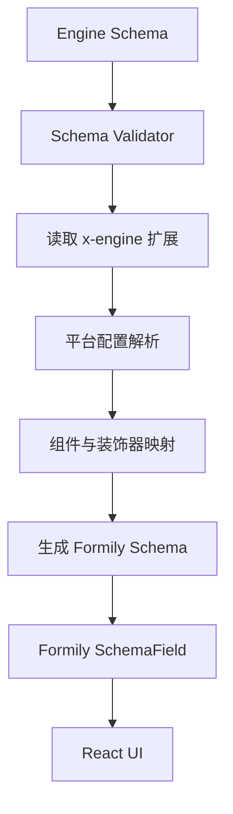

# 04. Formily 2.x Adapter 设计

## 1. 目标与边界

Formily Adapter 是 Form Engine 与 Formily 2.x 之间的适配层。它负责注册组件、装饰器和 Scope，接入原生 Formily 生命周期，并把引擎扩展元数据转换为 Formily 可消费的 Schema。

它不负责：

- 重写 Formily 的字段模型和响应式系统。
- 重新实现 Formily 的校验、Reaction 或 Effects。
- 让业务组件绕过 Formily 管理字段状态。
- 将 Designable 的设计器状态混入运行时 Formily Form。

## 2. 原生能力保留

应保留并通过适配层开放 Formily 原生能力：

- Form 创建与销毁。
- SchemaField 和组件映射。
- Field、ObjectField、ArrayField、VoidField。
- FormProvider、字段和表单 Hooks。
- `x-reactions`、`x-validator`、`x-decorator`。
- Form Effects 和字段生命周期订阅。
- 原生 Schema 表达式和 Scope 能力。

具体 API 的导出路径、参数和类型必须根据项目锁定的 Formily 2.x 版本验证，不应仅凭文档片段编写适配层。

## 3. 适配流程



## 4. 组件映射

Adapter 根据 Registry 获取目标平台组件：

```ts
interface FormilyComponentMap {
  components: Record<string, React.ComponentType<any>>;
  decorators: Record<string, React.ComponentType<any>>;
}
```

组件映射应在 Renderer 初始化时生成，并与当前 Engine Registry 版本保持一致。运行时动态注册组件时，需要明确是否支持热更新或要求重建 Renderer。

## 5. Schema 编译边界

Compiler 只处理 `x-engine`，例如：

- 平台属性合并。
- 数据源服务标识解析。
- 只读策略元数据提取。
- 快照策略提取。
- 权限展示策略解析。
- 组件能力检查。

Compiler 不应删除或重写未知的 Formily 原生字段。对未知 `x-engine` 扩展，应根据协议版本采取警告或拒绝策略。

## 6. Form 创建

每个 Renderer 实例应创建独立的 Formily Form。Engine 负责共享注册表、插件和服务，不共享所有表单的状态实例。

```tsx
function EngineFormRenderer({ engine, schema, initialValues }) {
  const form = useMemo(
    () => createForm({ values: initialValues }),
    [engine]
  );

  const schemaField = useMemo(
    () => createEngineSchemaField(engine, 'pc'),
    [engine]
  );

  return (
    <FormProvider form={form}>
      {schemaField({ schema })}
    </FormProvider>
  );
}
```

这是伪代码示意。实际 `createForm`、`createSchemaField`、SchemaField 调用和销毁 API 应按锁定版本实现，并确保 Form 在正确的生命周期中创建和释放。

## 7. Effects 组织

建议区分：

- 引擎内置 Effects：通用能力，如字段状态桥接。
- 组件 Effects：组件内部必要联动。
- 业务 Schema Reactions：由表单定义者配置。
- 应用注入 Effects：业务应用明确授权后注入。

不要把所有业务逻辑都塞进全局 Effects。每个 Effect 应有明确作用域和清理策略。

## 8. 数据更新策略

区分以下操作：

- 初始化：创建 Form 时设置初始值。
- 外部回填：业务主动设置值，应明确是否触发联动。
- 用户编辑：由字段交互自然触发。
- 重置：恢复初始状态。
- Schema 更新：判断是否需要重建 Form 或执行迁移。

避免 React 父组件每次 render 都重新创建 Form 或重复写入初始值。

## 9. 兼容性验证 Demo

在锁定版本前至少验证：

1. 普通字符串字段。
2. 自定义 React 字段组件。
3. 自定义 Decorator。
4. `x-reactions` 动态必填和显隐。
5. `onFieldValueChange` 等字段订阅。
6. Form Effects 注册与卸载。
7. Scope 中的方法在 Schema 表达式内可用。
8. ArrayField、ObjectField 嵌套。
9. 校验错误和异步校验。
10. Form 实例销毁后无残留订阅。

## 10. 验收标准

- Formily 原生 Schema 可直接运行。
- 引擎扩展编译不破坏原生能力。
- 每个 Renderer 拥有独立 Form 实例。
- 自定义组件和 Decorator 可从 Registry 映射。
- Effects 和订阅能正确清理。
- 版本升级时有自动化兼容测试。
