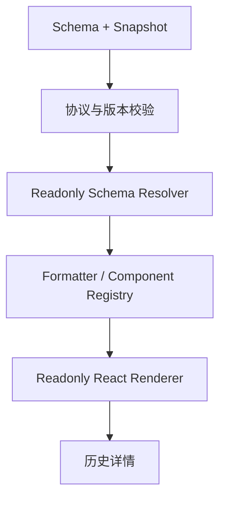

# 08. 独立只读渲染器设计

## 1. 目标

提供面向历史表单、审批详情和数据归档的独立只读渲染能力。只读展示不应简单复用编辑态组件并设置 `disabled`。

## 2. 独立的原因

编辑态组件可能包含：

- 远程搜索和异步请求。
- Formily Effects / Reactions。
- 可编辑弹层和选择器。
- 当前字典或组织架构数据依赖。
- 用户交互状态和校验逻辑。

历史详情需要稳定复现提交时的展示结果，因此应独立实现只读渲染器。

## 3. 输入协议

```ts
export interface ReadonlyRendererProps {
  schema: Record<string, unknown>;
  snapshot: FormSnapshot;
  locale?: string;
  platform?: 'pc' | 'mobile';
}

export interface ReadonlyComponentProps<Value = unknown> {
  value: Value;
  snapshotValue?: unknown;
  schema: Record<string, unknown>;
  locale?: string;
  context: ReadonlyRenderContext;
}
```

## 4. 渲染流程



## 5. Formatter Registry

建议提供通用格式化器：

| Formatter | 处理内容 |
|---|---|
| TextFormatter | 文本、数字 |
| DateFormatter | 日期和时间 |
| NumberFormatter | 数值精度 |
| CurrencyFormatter | 金额和币种 |
| EnumFormatter | 字典标签 |
| UserFormatter | 人员名称 |
| DepartmentFormatter | 部门名称 |
| FileFormatter | 文件列表 |
| AddressFormatter | 地址和地理位置 |

格式化器必须优先使用 Snapshot 中冻结的展示信息。只有明确允许时才回退到实时服务查询。

## 6. 历史数据优先级

推荐优先级：

1. Snapshot 中的 `displayValue`。
2. Snapshot 中的组件专属展示元数据。
3. Schema 中可确定的静态格式规则。
4. 明确允许的历史兼容查询。
5. 最终降级显示原始值，并提供诊断信息。

不能默认使用当前字典、当前人员名称覆盖历史快照。

## 7. 缺失组件处理

当历史 Schema 中的组件当前未注册：

- 显示通用值展示组件。
- 尽可能使用 Snapshot 的 `displayValue`。
- 标记组件缺失诊断信息。
- 不执行未知组件代码。
- 不静默丢弃字段。

## 8. 安全和性能

- 不执行 Schema 中任意脚本。
- 对富文本和链接进行安全处理。
- 对大表单采用分区渲染或虚拟化评估。
- 控制图片、附件和远程资源加载。
- 对敏感字段执行服务端脱敏和访问控制。
- 只读渲染器不得成为绕过后端权限的入口。

## 9. 验收标准

- 不创建编辑态 Formily Form。
- 不执行编辑态 Reactions 和 Effects。
- Snapshot 可独立完成历史展示。
- 当前数据源变化不影响历史展示。
- 未知组件和未知 Snapshot 版本可降级处理。
