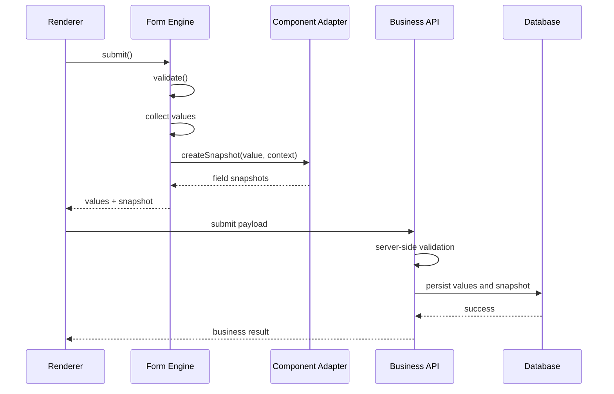

# 09. Value、Snapshot 与后端存储协议

## 1. 目标

明确 Schema、业务 Value、Snapshot 的职责边界，解决动态组件、远程数据源、历史回显、审批审计和版本迁移问题。

## 2. 三类数据

| 数据 | 代表内容 | 主要用途 |
|---|---|---|
| Schema | 字段结构、组件配置、联动规则 | 表单定义和渲染 |
| Value | 用户提交的业务值 | 业务计算、查询、审批 |
| Snapshot | 提交时的结构和展示信息 | 历史详情、审计和回放 |

三者不可混为一体。Snapshot 不是 Value 的简单副本，也不应把完整 Schema 在每次提交中无约束复制。

## 3. 建议持久化模型

### 表单定义

```text
form_definition
- id
- form_key
- name
- status
- created_at
- updated_at

form_schema_version
- id
- form_id
- version
- engine_schema_version
- schema_json
- published_at
- created_by
```

### 表单实例和提交记录

```text
form_instance
- id
- form_id
- form_version
- business_id
- status
- created_at
- updated_at

form_submission
- id
- instance_id
- schema_version
- values_json
- snapshot_json
- snapshot_version
- submitted_by
- submitted_at
```

具体表结构需结合业务数据库、审批流和数据保留策略调整。高频查询字段可按业务需要冗余索引，不建议把所有 JSON 字段都拆成关系表。

## 4. Snapshot 建议结构

```ts
export interface FormSnapshot {
  snapshotVersion: string;
  schemaId: string;
  schemaVersion: number;
  createdAt: string;
  locale?: string;
  values: Record<string, unknown>;
  fields: Record<string, FieldSnapshot>;
}

export interface FieldSnapshot {
  path: string;
  component: string;
  componentVersion?: string;
  title?: string;
  value: unknown;
  displayValue?: unknown;
  options?: Array<{
    label: string;
    value: unknown;
  }>;
  metadata?: Record<string, unknown>;
}
```

`fields` 建议使用稳定字段路径作为 Key。数组字段需定义路径规则，例如 `items[0].approver`，并确保前后端解析规则一致。

## 5. 人员选择示例

业务 Value：

```json
{
  "applicant": "u_10001"
}
```

Snapshot：

```json
{
  "snapshotVersion": "1.0",
  "schemaId": "leave-form",
  "schemaVersion": 3,
  "createdAt": "2026-01-01T08:00:00.000Z",
  "values": {
    "applicant": "u_10001"
  },
  "fields": {
    "applicant": {
      "path": "applicant",
      "component": "UserSelect",
      "componentVersion": "1.0.0",
      "title": "申请人",
      "value": "u_10001",
      "displayValue": {
        "id": "u_10001",
        "name": "张三",
        "departmentName": "研发部"
      }
    }
  }
}
```

多选时 Value 保存 ID 数组，Snapshot 保存对应展示对象数组。

## 6. 快照生成流程



如果 Snapshot 生成依赖后端才能获得权威展示信息，应设计明确的后端快照生成接口或提交前解析流程，不要让浏览器伪造权威组织信息。

## 7. 远程组件数据策略

人员、部门、字典、远程下拉等组件：

- Value 保存稳定业务标识。
- Snapshot 保存提交时的必要展示字段。
- 组件 Adapter 负责把组件值映射为标准结构。
- 数据源服务负责查询、分页、取消和缓存。
- 后端提交时应校验标识有效性和用户权限。
- 历史展示优先使用 Snapshot，避免实时查询导致名称变化。

## 8. 版本管理与迁移

至少维护两个独立版本：

- `schemaVersion`：业务表单结构版本。
- `snapshotVersion`：快照协议版本。

必要时还需记录 `engineSchemaVersion` 和组件版本。

迁移策略：

1. 读取时识别版本。
2. 使用有序迁移链转换。
3. 迁移失败时保留原始数据并返回可诊断错误。
4. 不覆盖原始历史快照。
5. 对重要审批记录保留迁移前后校验信息。

## 9. 一致性和事务

- Value 与 Snapshot 应在同一次业务提交中关联保存。
- 后端应校验 Schema 版本与当前实例允许的版本。
- 业务状态更新和提交记录持久化应处于合适的事务边界。
- 幂等提交应有请求标识或业务幂等键。
- Snapshot 生成失败的处理策略需由业务等级决定；审批和审计场景通常应阻断提交或采用经过评审的降级机制。

## 10. 安全与隐私

- Snapshot 只保存历史展示必需的信息。
- 身份证号、手机号等敏感字段应按业务需要脱敏或加密。
- 访问 Snapshot 必须经过后端鉴权。
- 不把前端 `displayValue` 直接当作权威身份信息。
- 设置保留期限、删除策略和审计记录。

## 11. 验收标准

- Value 可独立用于业务处理。
- Snapshot 可独立用于历史展示。
- 字典和组织信息变化不会改变历史展示。
- 旧版本 Schema 和 Snapshot 有迁移策略。
- 后端验证 Value、权限和业务规则。
- Value 与 Snapshot 关联保存且支持幂等。
