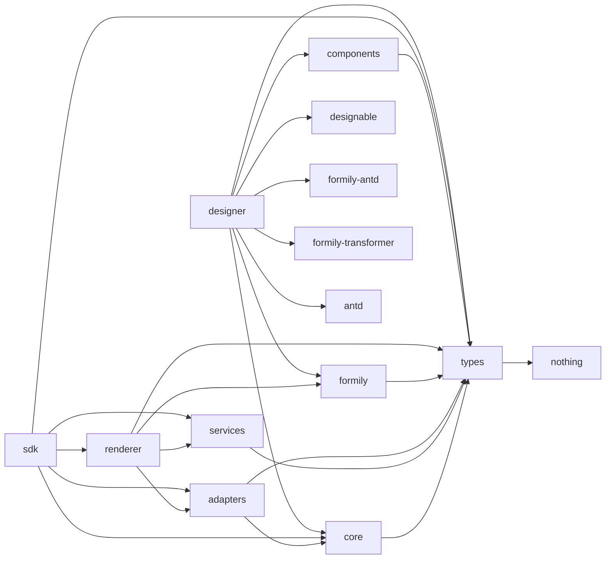

# Form Engine V2 架构改造审计报告（Phase 0）

> 依据：`docs/architecture/02-form-engine-v2-task.md` Phase 0 / Task 0.1 / Task 0.2
> 审计日期：2026-11-12
> 审计结论：仓库现状与任务书描述基本一致，Phase 0 可直接进入 Phase 1；无“暂停条件”命中。
> 关键结论一句话：当前没有独立 Designer Core / Material Registry / Setter Registry / Designer Plugin Host，现有 `packages/designer` 是 **Designable 强耦合的 M2 闭环**，需要按 Phase 1→2→3→4→5 抽取。

---

## 1. 当前实际 package 结构

pnpm monorepo（`pnpm@10.34.5`），workspace 范围见 `pnpm-workspace.yaml`：

```yaml
packages:
  - 'packages/*'
  - 'apps/*'
```

实际包：

| 包 | 名称 | 状态 |
|---|---|---|
| `packages/types` | `@x-form-engine/types` | 已实现 |
| `packages/core` | `@x-form-engine/core` | 已实现 |
| `packages/formily` | `@x-form-engine/formily` | 已实现 |
| `packages/renderer` | `@x-form-engine/renderer` | 已实现（PC + Mobile + Readonly） |
| `packages/components` | `@x-form-engine/components`（含 `./mobile` 子路径） | 已实现 |
| `packages/sdk` | `@x-form-engine/sdk` | 已实现 |
| `packages/designer` | `@x-form-engine/designer` | 已实现（Designable 耦合） |
| `packages/adapters` | `@x-form-engine/adapters` | 已实现 |
| `packages/services` | `@x-form-engine/services` | 已实现 |
| `apps/playground` | `playground` | M1 demo |
| `apps/designer-demo` | `designer-demo` | M2 demo |
| `apps/mobile-demo` | `mobile-demo` | M4 demo |

任务书目标中尚不存在的包：`designer-core`、`designer-designable`、`materials-basic`、`setters-basic`、`plugins-basic`、高级扩展包。

---

## 2. 现有模块职责

### `packages/types`

纯协议类型，无 React/Formily/Designable 依赖（由 `src/__tests__/no-react-deps.test.ts` 静态守卫）。关键文件与符号：

- `src/base.ts`：`Platform`、`RenderMode`、`JsonValue`、`FieldPath`、`ComponentName`、`PluginName`
- `src/schema.ts`：`ENGINE_SCHEMA_VERSION`、`FormSchemaDocument`
- `src/component.ts`：`ComponentBinding`、`ComponentProtocolDefinition`、`ComponentImplementations`、`ComponentAdapter`（含 `restoreSnapshot?` 仅类型声明）、`PlatformFallbackDiagnostic`
- `src/engine.ts`：`Registry<T>`、`RegistryEntry<T>`、`EngineRegistry`、`FormEnginePlugin`、`FormEngineOptions`、`FormEngine`
- `src/value.ts`：`SNAPSHOT_VERSION`、`FormValue`、`FormSubmitResult`、`FormSnapshot`、`FieldSnapshot`、`RepeatItemSnapshot`、`CandidateSnapshot`、`CanonicalSnapshot`
- `src/errors.ts`：`FormEngineErrorCode`、`FormEngineError`
- `src/{services,permission,formatter,i18n,migration,readonly}.ts`：服务/权限/格式化/国际化/迁移/只读协议

### `packages/core`

无 React 依赖的引擎内核。关键文件与符号：

- `src/registry/registry.ts`：`createRegistry<T>()`
- `src/registry/engine-registry.ts`：`createEngineRegistry()`
- `src/plugin/dependency-resolver.ts`：`resolvePluginOrder()`
- `src/plugin/plugin-manager.ts`：`createPluginManager(engine)`、`PluginManager`
- `src/engine.ts`：`createFormEngine()`、`Engine`、`BUILTIN_SOURCE`
- `src/schema/parser.ts`：`parseSchemaDocument()`
- `src/schema/validator.ts`：`validateEngineSchema()`、`KNOWN_X_ENGINE_KEYS`
- `src/events/event-bus.ts`：`createEventBus()`
- `src/migration/migration-registry.ts`：`createMigrationRegistry()`
- `src/identity/field-identity.ts`：`joinFieldId()`、`createItemId()`、`extractStableItemKey()`

### `packages/formily`

Formily 适配层。关键文件与符号：

- `src/component-map.ts`：`resolveFormilyComponentMap()`、`resolveImplementation()`（PC 严格 / Mobile 回退 + 诊断）
- `src/create-schema-field.ts`：`createEngineSchemaField()`

### `packages/renderer`

UI 无关渲染核心 + React 入口 + 独立只读渲染器。关键文件与符号：

- `src/context.tsx`：`FormEngineProvider`、`useFormEngine`
- `src/FormRenderer.tsx`：`FormRenderer`（编辑态，`submit()` 做 Value 规范化 + 权限过滤 + Candidate Snapshot，不做 HTTP）
- `src/diagnostics.ts`：`collectSchemaComponentRefs()`、`filterDiagnosticsBySchema()`
- `src/readonly/ReadonlyRenderer.tsx`：`ReadonlyRenderer`（不创建 Formily Form，不执行编辑态 reactions/effects）
- `src/types.ts`：`FormRendererProps`、`FormRendererInstance`

### `packages/components`

共享组件定义 + 平台实现。关键文件与符号：

- `src/definitions/basic.ts`：`basicComponents`（Input/Textarea/Number/Select/Radio/Checkbox/DatePicker，PC 实现来自 `@formily/antd`）
- `src/definitions/decorators.ts`：`basicDecorators`（FormItem）
- `src/mobile/index.ts`：移动端 `basicComponents` / `basicDecorators`（antd-mobile）
- `src/readonly/readonly-components.tsx`：`ReadonlyText`、`readonlyComponents`
- `src/shared/protocols.ts`：`createBasicProtocol()`、`createFormItemProtocol()`、`BASIC_COMPONENT_SPECS`
- `src/types.ts`：`ReactComponentBinding`、`ReadonlyComponent`

### `packages/sdk`

业务项目唯一公开入口（`src/index.ts`），聚合 `types/core/adapters/services/renderer`，不含 Designable（`src/__tests__/no-designable-dep.test.ts` 静态守卫）。

### `packages/adapters`

Value 规范化 + Candidate Snapshot + 实体/字典参考适配器。UI 无关（`src/__tests__/no-ui-deps.test.ts` 静态守卫）。关键符号：`normalizeFormValues()`、`createCandidateSnapshot()`、`normalizeEntityValue()`、`createEntitySnapshots()`、`createDictSnapshot()`。

### `packages/services`

权限解析 / Formatter / i18n / 静态数据源。UI 无关（`src/__tests__/no-ui-deps.test.ts` 静态守卫）。关键符号：`resolveFieldAccess()`、`resolveFormAccess()`、`canSubmit()`、`filterWritableValues()`、`defaultFormatters`、`defaultFormattersPlugin`、`createI18nService()`、`createStaticDatasourceService()`。

### `packages/designer`

当前 Designer 实现（M2 闭环），**与 Designable 强耦合**。关键文件：

- `src/designer.ts`：`createEngineDesigner(materials)`
- `src/materials.ts`：`createDesignerMaterials(bindings)`、`DesignerMaterialMap`、`DesignerHostComponent`
- `src/schema-io.ts`：`exportSchemaDocument()`、`importSchemaDocument()`
- `src/setters.tsx`：`OptionsSetter`
- `src/preview.tsx`：`DesignerPreview`

---

## 3. 现有依赖关系

依赖方向（`→` 表示依赖）：



关键事实（依据各包 `package.json`）：

- `types` 无任何 dependencies。
- `core` 仅依赖 `@x-form-engine/types`（`core/registry` 不依赖 React）。
- `renderer` 不依赖 Ant Design；`renderer` 依赖 `adapters/formily/services/types`。
- `designer` 不依赖 `@x-form-engine/renderer`（`src/__tests__/no-renderer-dep.test.ts` 静态守卫）。
- `designer` 依赖 Designable 全家桶（`@designable/{core,react,react-settings-form,formily-antd,formily-setters,formily-transformer,shared}`）以及 `antd`、`@formily/*`、`@x-form-engine/{types,core,formily,components}`。
- `sdk` 不依赖 Designable（`src/__tests__/no-designable-dep.test.ts` 静态守卫）。

现有边界与任务书目标边界存在的主要差异：

1. `designer` 目前直接 import Designable（`@designable/*`），没有 Adapter 隔离层（违反 C3/C11/C13 目标）。
2. `designer` 依赖 `components`，而 `components` 同时带 `antd` 与 `antd-mobile`；这使“Designer Core 不依赖 antd/antd-mobile”的边界尚不成立。
3. `designer` 依赖 `@formily/antd`（通过 `@designable/formily-antd` 与 `materials.ts` 的 `Field/Form`），Designer Core 目标应只允许 React + types/protocol + Generic Plugin Core。

---

## 4. 当前 Designer 与 Designable 的耦合点

| 文件 | 耦合点（import 来源） | 说明 |
|---|---|---|
| `designer/src/designer.ts` | `@designable/core`：`GlobalRegistry`、`TreeNode`、`createDesigner`、`IDesignerBehaviors` | 直接创建 Designable engine，`createEngineDesigner` 返回值就是 Designable engine |
| `designer/src/materials.ts` | `@designable/core`：`createBehavior/createResource`；`@designable/formily-antd`：`Field/Form`；`@designable/react`：`DnComponent`；`@formily/json-schema`：`ISchema` | ComponentBinding → Designable Host 的转换工厂，返回的是挂载 `Behavior/Resource` 的 React 组件 map |
| `designer/src/schema-io.ts` | `@designable/core`：`TreeNode`；`@designable/formily-transformer`：`transformToSchema/transformToTreeNode` | Schema ↔ TreeNode 双向转换 |
| `designer/src/setters.tsx` | `antd`：`Button/Input` | 无 Designable 依赖，但 UI 写在 designer 内 |
| `designer/src/preview.tsx` | `@formily/core`、`@formily/react`、`@x-form-engine/formily` | 无 Designable 依赖，走 Formily 编译链路 |
| `apps/designer-demo/src/App.tsx` | `@designable/react`、`@designable/react-settings-form`、`@designable/core` | Demo 层大量直接使用 Designable Workbench Widgets |

抽取边界建议：`designer-core` 只能保留 `designer.ts` 中的生命周期语义（去 Designable）、`materials.ts` 中的“定义→Material”逻辑（去 Designable 专属字段）、`schema-io.ts` 中的信封/一致性校验（去 `transformToSchema/transformToTreeNode` 的调用层）。`transformToSchema/transformToTreeNode`、`TreeNode`、`Behavior/Resource`、`Field/Form` 都必须落入 Adapter 包。

---

## 5. 当前 Material / Setter 实现情况

### Material

- 没有独立的 Material Registry。`createDesignerMaterials(bindings)` 是 ComponentBinding → Designable 宿主组件的派生工具，返回值是 `DesignerMaterialMap = Record<string, DesignerHostComponent>`（`designer/src/materials.ts`）。
- 派生过程中 `basicComponents`（7 个 PC 组件）+ `FormHost` + `Field` + `FormItem` 组成画布物料；`bindings.forEach` 中若 `binding.implementations.pc` 缺失会 **静默 return 跳过**（`materials.ts` 的 `if (!host) return;`）——这正是任务书 C4/C5 指出的现状，Phase 5.6 需要改为显式诊断。
- 组件协议 `ComponentProtocolDefinition` 已存在，`ComponentBinding` 是运行时组件绑定核心，但 Material 定义类型（`DesignerMaterialDefinition`）尚不存在。

### Setter

- 没有 Setter Registry。当前只有单个 `OptionsSetter`（`designer/src/setters.tsx`），并被 `designer-demo/src/App.tsx` 手工塞进 `SettingsForm` 的 `components` map。
- `materials.ts` 内部用 `OPTIONS_SETTER = 'OptionsSetter'` 字符串作为 `x-component`，缺少 Setter 定义/注册/解析/诊断闭环。

---

## 6. Runtime Plugin Manager 可复用能力与可抽取的泛型边界

事实来源：`packages/core/src/plugin/plugin-manager.ts`、`packages/core/src/plugin/dependency-resolver.ts`。

当前 `createPluginManager(engine)` 的硬编码耦合：

- 依赖 `FormEngine` 类型（读 `engine.registry` / `engine.services` / `engine.events` / `engine.options`）。
- 硬编码 5 类 `RegistryKind`：`components | decorators | services | formatters | designer`。
- `PluginManager` 只暴露 `install` / `disposeAll` / `list`，**没有单插件 `uninstall(name)` 与依赖保护**（任务书 Phase 2 目标需要新增）。

已具备的可复用能力（抽取为泛型核心）：

1. 重复安装检测（`installedNames` Set → `PLUGIN_CONFLICT`）。
2. 依赖解析与拓扑排序（`resolvePluginOrder`，Kahn 算法；缺依赖 → `PLUGIN_DEPENDENCY_MISSING`，重名/环 → `PLUGIN_CONFLICT`）。
3. 事务性安装：安装前快照 → 安装失败回滚本次新增资源。
4. 增量快照归属：`snapshotAll` + `collectNewRegistrations`，只回滚本次新增、不误删同 `source` 旧资源。
5. `disposeAll` 逆序卸载、幂等、单插件 dispose 异常隔离、`finally` 保证资源释放。

可抽取的泛型边界（Phase 2 目标）：

- 泛型 `PluginDefinition` / `PluginRegistry`（依赖解析用）替代 `FormEnginePlugin`。
- 泛型 `PluginHost` 注入“资源注册表集合 + 生命周期上下文”，替代硬编码 5 类 `RegistryKind` 和 `FormEngine` 直读。
- 新增 `uninstall(name)` 依赖保护（依赖者仍安装时拒绝卸载依赖项）。

当前 `plugin.test.ts`（13 用例）已覆盖：注册/重复/安装/依赖拓扑/回滚/归属/逆序/disposeAll 等；`uninstall` 与“依赖保护”是当前缺项。

---

## 7. 与目标架构的差异

| 目标模块 | 当前状态 | 差异 |
|---|---|---|
| Generic Plugin Core | 待抽取 | 现在散落在 `plugin-manager.ts` + `dependency-resolver.ts`，与 `FormEngine`/5 类 Registry 强耦合；无 `uninstall` |
| Runtime Plugin Host | `createPluginManager` | 现状即 Runtime 专用，Phase 3 迁到泛型核心之上 |
| Designer Core | 不存在 | 现在是 `createEngineDesigner` 直接返回 Designable engine |
| Designable Adapter | 不存在 | Designable 耦合散在 `designer.ts/materials.ts/schema-io.ts` |
| Material Registry | 不存在 | 仅有 `createDesignerMaterials` 派生工厂，无注册/卸载/校验/诊断 |
| Setter Registry | 不存在 | 仅有 `OptionsSetter` 组件，无定义/注册/解析 |
| Designer Plugin Host | 不存在 | 无任何 Designer 插件机制 |
| Component Registry | `createRegistry/createEngineRegistry` | 已满足，保留 |
| ComponentBinding | `types/component.ts` + `components` 定义 | 已满足，保留 |
| Schema 解析/校验 | `core/schema/{parser,validator}.ts` | 已满足，保留 |
| Runtime Renderer | `renderer/FormRenderer.tsx` | 已满足，保留 |
| Readonly Renderer | `renderer/readonly/ReadonlyRenderer.tsx` | 已满足，保留 |
| Material → Schema → Runtime 一致性 | 不存在 | Phase 7 新增 Contract Tests |

---

## 8. 具体需要新增、修改、保留的文件

### 保留（不重写）

- `packages/types/src/{schema,component,engine,value,errors,...}.ts`：协议类型权威。
- `packages/core/src/registry/{registry,engine-registry}.ts`、`packages/core/src/schema/{parser,validator,internal}.ts`、`packages/core/src/engine.ts`、`packages/core/src/migration/*`、`packages/core/src/identity/*`、`packages/core/src/events/event-bus.ts`。
- `packages/formily/*`、`packages/renderer/*`、`packages/adapters/*`、`packages/services/*`、`packages/components/*`、`packages/sdk/*`。

### 新增（按 Phase）

- Phase 1：在 `packages/types` 扩展 `designer.ts`（`DesignerMaterialDefinition`、`MaterialRuntimeTarget`、`Setter*`、`SchemaDiagnostic`、`DesignerPlugin*`、`SchemaEditor` 协议、Generic Plugin Core 最小类型）。不新建类型包。
- Phase 2：`packages/core/src/plugin/generic-plugin-core.ts`（或 `plugin-core/` 子目录）——泛型生命周期编排；配套单测。
- Phase 3：改造 `packages/core/src/plugin/plugin-manager.ts` 复用泛型核心，保持 `createPluginManager` 公开行为。
- Phase 4：新增 `packages/designer-core/`（若决定独立立包）或在现有 `packages/designer` 内先建立逻辑边界：`engine/context/registry(5 类)/plugin-host/schema-editor/events/lifecycle/diagnostics`。
- Phase 5：新增 `packages/designer-designable/`（或 `designer/src/designable/`）承载 `designer.ts/materials.ts/schema-io.ts` 中的 Designable 专属逻辑 + Adapter 接口。
- Phase 6：新增 `materials-basic`、`setters-basic`、`plugins-basic`（或先落在 `packages/designer` 内）。
- Phase 7：新增 Contract Tests（Material/Schema/Runtime Binding）。
- Phase 8：高级 Setter/Plugin 扩展示例。
- Phase 9：公开入口/Demo/文档/发布统一。

### 修改（关键）

- `packages/designer/src/materials.ts`：去“缺 `implementations.pc` 静默跳过”，改为显式诊断；`createDesignerMaterials` 保留为 Adapter 内派生工厂。
- `packages/designer/src/designer.ts`：抽离 Designable `createDesigner`，让 Designer Core 可独立实例化。
- `packages/designer/src/schema-io.ts`：拆分“信封/一致性校验（Core 可复用）”与“Designable transformer（Adapter）”。
- `packages/designer/src/setters.tsx`：纳入 Setter 定义/注册体系。
- `AGENTS.md`、`docs/README.md`：Phase 9.6 更新。

---

## 9. 可能影响现有 API 的兼容风险

1. **Generic Plugin Core 抽取（R1，最高风险）**：`createPluginManager` 是 Runtime 插件行为的事实基础；抽取后必须先绿 Runtime 插件回归（Phase 3），否则不能进 Phase 4。
2. **Material 一等公民化（R2）**：新增 `componentName ↔ Runtime registry ↔ Schema` 一致性校验，避免“画了但 Runtime 渲染不出”的静默失配；当前 `materials.ts` 静默跳过无 PC 实现项，改造时会产生新的诊断行为（不再静默）。
3. **双轨 Designer（R3）**：`packages/designer` 与目标 `designer-core` + `designer-designable` 并存期间不得长期双轨，Phase 9 必须统一切换。
4. **`FormSchemaDocument.schema` 是 `Record<string, unknown>`**（`types/schema.ts`），不得收窄为 `ISchema`（C1）；`ISchema` 只在 Designer Adapter 内部使用。
5. **Designer 当前依赖 `components`**，而 `components` 带 `antd` + `antd-mobile`；抽取 `designer-core` 时必须切断对 `components` 的运行依赖，否则 C13 依赖检查不过。
6. **Designable 类型泄漏**：`designer.ts` 的返回类型是 `ReturnType<typeof createDesigner>`，`materials.ts` 暴露 `DnComponent`、`ISchema`；公开 API 必须收窄。
7. **依赖实例重复**：`node_modules/.pnpm` 内存在多个 `react-is`（16/17/18/19）与多份 `@formily/react`、`@designable/react` peer 变体，vite demo 靠 `resolve.dedupe` 兜底；拆包/建包后需重新验证单实例。
8. **`restoreSnapshot` 仅类型声明**（`types/component.ts`），不得在 V2 中标记为已实现（C6）。

---

## 10. 建议实施顺序

严格按任务书：Phase 0（本报告）→ Phase 1（协议/依赖边界）→ Phase 2（Generic Plugin Core，独立验收）→ Phase 3（Runtime Plugin Host 迁移回归）→ Phase 4（Designer Core）→ Phase 5（Designable Adapter）→ Phase 6（基础物料/Setter/Plugin）→ Phase 7（一致性 Contract Tests）→ Phase 8（高级扩展示例）→ Phase 9（统一切换/文档/发布）。

每阶段结束：跑测试、`tsc --noEmit`、对应包 `tsup` 构建、循环依赖检查，再进入下一阶段。

---

## 附：审计依据清单（文件 / 符号 / 测试）

- 包结构：`pnpm-workspace.yaml`、`packages/*/package.json`、`apps/*/package.json`。
- 公开类型：`packages/types/src/*.ts`，聚合于 `src/index.ts`。
- Plugin 行为：`packages/core/src/plugin/plugin-manager.ts`（`createPluginManager`）、`packages/core/src/plugin/dependency-resolver.ts`（`resolvePluginOrder`）；测试 `packages/core/src/plugin/plugin.test.ts`（13 用例）。
- Schema：`packages/types/src/schema.ts`（`FormSchemaDocument`）、`packages/core/src/schema/{parser,validator}.ts`；测试 `packages/core/src/schema/schema.test.ts`（6 用例）。
- Material/Binding 对照：`packages/components/src/definitions/{basic,decorators}.ts`、`packages/components/src/shared/protocols.ts`、`packages/designer/src/materials.ts`；测试 `packages/designer/src/__tests__/materials.test.tsx`（7 用例）。
- Schema 往返：`packages/designer/src/schema-io.ts`；测试 `packages/designer/src/__tests__/schema-io.test.ts`（6 用例）。
- 依赖边界：`packages/designer/src/__tests__/no-renderer-dep.test.ts`、`packages/sdk/src/__tests__/no-designable-dep.test.ts`、`packages/adapters/src/__tests__/no-ui-deps.test.ts`、`packages/services/src/__tests__/no-ui-deps.test.ts`、`packages/types/src/__tests__/no-react-deps.test.ts`。
- 当前基线：`pnpm -r typecheck` 全绿；`pnpm test:run` 49 文件 / 201 用例全绿（2026-11-12）。
