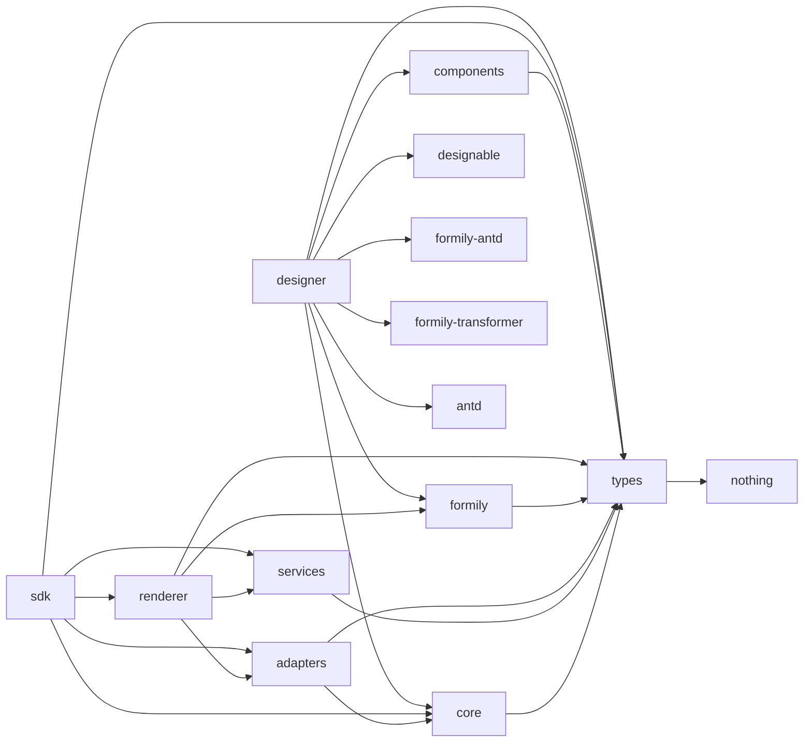

# Form Engine V2 架构改造审计报告（Phase 0，重新审计）

> 依据：`docs/architecture/02-form-engine-v2-task.md` Phase 0 / Task 0.1 / Task 0.2
> 审计日期：2026-11-13（重新审计，不沿用 2026-11-12 结论）
> 审计结论：相对上一轮审计，**Phase 1 公共协议、Phase 2 Generic Plugin Core、Phase 3 Runtime Plugin Host 迁移均已落地**；Phase 4（Designer Core）及之后仍未开始。当前可直接进入 Phase 4，无“暂停条件”命中。
> 关键结论一句话：`types` 已具备 V2 公共协议（`designer.ts`/`plugin.ts`），`core` 已具备泛型插件编排核心，但**独立 Designer Core / Material Registry / Setter Registry / Designer Plugin Host 仍不存在**，`packages/designer` 依然是 Designable 强耦合的 M2 闭环。

---

## 1. 当前实际 package 结构

pnpm monorepo（`pnpm@10.34.5`），workspace 范围见 `pnpm-workspace.yaml`：

```yaml
packages:
  - 'packages/*'
  - 'apps/*'
```

实际包：

| 包 | 名称 | 状态 |
|---|---|---|
| `packages/types` | `@x-form-engine/types` | 已实现（含 V2 公共协议，见 §5） |
| `packages/core` | `@x-form-engine/core` | 已实现（含 Generic Plugin Core，见 §6） |
| `packages/formily` | `@x-form-engine/formily` | 已实现 |
| `packages/renderer` | `@x-form-engine/renderer` | 已实现（PC + Mobile + Readonly） |
| `packages/components` | `@x-form-engine/components`（含 `./mobile` 子路径） | 已实现 |
| `packages/sdk` | `@x-form-engine/sdk` | 已实现 |
| `packages/designer` | `@x-form-engine/designer` | 已实现（Designable 耦合，未抽离） |
| `packages/adapters` | `@x-form-engine/adapters` | 已实现 |
| `packages/services` | `@x-form-engine/services` | 已实现 |
| `apps/playground` | `playground` | M1 demo |
| `apps/designer-demo` | `designer-demo` | M2 demo |
| `apps/mobile-demo` | `mobile-demo` | M4 demo |

任务书目标中尚不存在的包：`designer-core`、`designer-designable`、`materials-basic`、`setters-basic`、`plugins-basic`、高级扩展包。

---

## 2. 现有模块职责

### `packages/types`

纯协议类型，无 React/Formily/Designable 依赖（由 `src/__tests__/no-react-deps.test.ts` 静态守卫）。关键文件与符号：

- `src/base.ts`：`Platform`、`RenderMode`、`JsonValue`、`FieldPath`、`ComponentName`、`PluginName`
- `src/schema.ts`：`ENGINE_SCHEMA_VERSION`、`FormSchemaDocument`、`DesignerMetadata`（C1 兼容扩展）
- `src/component.ts`：`ComponentBinding`、`ComponentProtocolDefinition`、`ComponentImplementations`、`ComponentAdapter`（`restoreSnapshot?` 仅类型声明，C6）、`PlatformFallbackDiagnostic`
- `src/engine.ts`：`Registry<T>`、`RegistryEntry<T>`、`EngineRegistry`、`FormEnginePlugin`、`FormEngineOptions`、`FormEngine`
- `src/designer.ts`：**V2 Designer 公共协议（Phase 1 新增）**——`DesignerMaterialDefinition`、`MaterialRuntimeTarget`、`Setter*`、`SchemaDiagnostic`、`DesignerPlugin*`、`SchemaEditor`、`DesignerEnginePublicAPI`、`DesignerAdapter` 等（详见 §5）
- `src/plugin.ts`：**Generic Plugin Core 通用契约（Phase 1 新增）**——`PluginDefinition`、`PluginRegistry`、`DependencyEdge`、`PluginStatus`、`PluginInstallOptions`、`PluginDependencyError`、`PluginLifecycleEvent`
- `src/value.ts`、`src/errors.ts`、`src/{services,permission,formatter,i18n,migration,readonly}.ts`：值/快照/服务/权限/格式化/国际化/迁移/只读协议

### `packages/core`

无 React 依赖的引擎内核。关键文件与符号：

- `src/registry/registry.ts`：`createRegistry<T>()`
- `src/registry/engine-registry.ts`：`createEngineRegistry()`
- `src/plugin/generic/dependency-resolver.ts`：`resolvePluginOrder()`（泛型化，Phase 2）
- `src/plugin/generic/plugin-host.ts`：`createGenericPluginHost()`、`GenericPluginHost`、`PluginResourceRegistry`（Phase 2）
- `src/plugin/plugin-manager.ts`：`createPluginManager(engine)`、`PluginManager`（已迁到泛型核心之上，Phase 3）
- `src/engine.ts`：`createFormEngine()`、`Engine`
- `src/schema/parser.ts`：`parseSchemaDocument()`
- `src/schema/validator.ts`：`validateEngineSchema()`、`KNOWN_X_ENGINE_KEYS`
- `src/events/event-bus.ts`、`src/migration/migration-registry.ts`、`src/identity/field-identity.ts`

### `packages/formily`

Formily 适配层。`src/component-map.ts`：`resolveFormilyComponentMap()`、`resolveImplementation()`（PC 严格 / Mobile 回退 + 诊断）；`src/create-schema-field.ts`：`createEngineSchemaField()`。

### `packages/renderer`

UI 无关渲染核心 + React 入口 + 独立只读渲染器。`FormRenderer`（编辑态，`submit()` 做 Value 规范化 + 权限过滤 + Candidate Snapshot，不做 HTTP）、`ReadonlyRenderer`（不创建 Formily Form，不执行编辑态 reactions/effects）、`diagnostics.ts`。

### `packages/components`

共享组件定义 + 平台实现：`definitions/basic.ts`（PC 7 组件）、`definitions/decorators.ts`、`mobile/`（antd-mobile）、`readonly/`、`shared/protocols.ts`。

### `packages/sdk`

业务项目唯一公开入口，聚合 `types/core/adapters/services/renderer`，不含 Designable（`no-designable-dep.test.ts` 守卫）。

### `packages/adapters` / `packages/services`

Value 规范化 + Candidate Snapshot + 实体/字典参考适配器（`adapters`）；权限解析 / Formatter / i18n / 静态数据源（`services`）。均 UI 无关（各自 `no-ui-deps.test.ts` 守卫）。

### `packages/designer`

当前 Designer 实现（M2 闭环），**与 Designable 强耦合**。`createEngineDesigner(materials)`（`designer.ts`）、`createDesignerMaterials(bindings)`（`materials.ts`）、`exportSchemaDocument/importSchemaDocument`（`schema-io.ts`）、`OptionsSetter`（`setters.tsx`）、`DesignerPreview`（`preview.tsx`）。

---

## 3. 现有依赖关系



关键事实（依据各包 `package.json`）：

- `types` 无任何 dependencies；`core` 仅依赖 `@x-form-engine/types`。
- `renderer` 不依赖 Ant Design；依赖 `adapters/formily/services/types`。
- `designer` 不依赖 `@x-form-engine/renderer`（`no-renderer-dep.test.ts` 守卫），但依赖 Designable 全家桶 + `antd` + `@formily/*` + `@x-form-engine/{types,core,formily,components}`。
- `sdk` 不依赖 Designable。

与目标边界的主要差异（Phase 4/5 要解决，不在本阶段）：

1. `designer` 直接 import Designable（`@designable/*`），无 Adapter 隔离层（C3/C11/C13）。
2. `designer` 依赖 `components`，而 `components` 带 `antd` + `antd-mobile`，使“Designer Core 不依赖 antd/antd-mobile”边界尚不成立。
3. 尚无 `designer-core` 包：Designer Core 目标应只允许 React（peer）+ types/protocol + Generic Plugin Core。

---

## 4. 当前 Designer 与 Designable 的耦合点

| 文件 | 耦合点（import 来源） | 说明 |
|---|---|---|
| `designer/src/designer.ts:1-3` | `@designable/core`：`GlobalRegistry`、`TreeNode`、`createDesigner`、`IDesignerBehaviors` | `createEngineDesigner` 直接创建并返回 Designable engine |
| `designer/src/materials.ts:1-8` | `@designable/core`：`createBehavior/createResource`；`@designable/formily-antd`：`Field/Form`；`@designable/react`：`DnComponent`；`@formily/json-schema`：`ISchema` | ComponentBinding → Designable Host 转换工厂 |
| `designer/src/schema-io.ts:1-3` | `@designable/core`：`TreeNode`；`@designable/formily-transformer`：`transformToSchema/transformToTreeNode` | Schema ↔ TreeNode 双向转换 |
| `designer/src/setters.tsx:1` | `antd`：`Button/Input` | UI 写在 designer 内 |
| `designer/src/preview.tsx:1-5` | `@formily/core`、`@formily/react`、`@x-form-engine/formily` | 无 Designable，走 Formily 编译链路 |
| `apps/designer-demo/src/App.tsx` | `@designable/react`、`@designable/react-settings-form`、`@designable/core` | Demo 直接使用 Designable Workbench |

抽取边界：`designer-core` 只保留生命周期/协议/注册表/诊断逻辑（去 Designable）；`TreeNode`、`transformToSchema/transformToTreeNode`、`Behavior/Resource`、`Field/Form` 必须落入 `designer-designable` Adapter 包。

---

## 5. 当前 Material / Setter 实现情况

### 公共协议（Phase 1 已落地）

`packages/types/src/designer.ts` 已定义（均为 `unknown`/`Record` 占位的 UI/Formily 无关协议）：

- `DesignerMaterialDefinition` + `MaterialRuntimeTarget`（`component` / `schema-container` / `designer-only` 三态，C10）
- `MaterialCapabilities`、`MaterialCreateContext`、`DesignerComponentProps`
- `SetterProps<T>`、`SetterDefinition`、`SetterBinding`、`SetterContext`、`ValidationResult`、`SetterRegistryOptions`、`SetterResolveResult`
- `SchemaDiagnostic`、`SchemaDiagnosticSeverity`、`SchemaEditor`、`SchemaNode`、`DesignerEvent`
- `DesignerPlugin`、`DesignerPluginContext`、`DesignerPluginHost`、`DesignerEnginePublicAPI`、`CreateDesignerOptions`、`DesignerAdapter`、`DesignerWorkspace`
- `PanelDefinition/CommandDefinition/ToolbarDefinition` 及对应 Registry 类型

配套类型级测试 `__tests__/designer-types.test.ts`（15 用例）与依赖边界守卫 `__tests__/no-react-deps.test.ts`（5 用例）。

### 运行时 Registry（尚不存在）

- **没有 Material Registry 运行时实现**。`createDesignerMaterials(bindings)`（`designer/src/materials.ts:115`）仍是 ComponentBinding → Designable 宿主组件的派生工具，返回 `DesignerMaterialMap = Record<string, DesignerHostComponent>`。
- 派生过程中对缺 `implementations.pc` 的 binding **静默 return 跳过**（`materials.ts:127-130` 的 `if (!host) return;`）——这是任务书 C4/C5 指出的现状，Phase 5.6 需改为显式诊断。
- **没有 Setter Registry 运行时实现**。当前只有单个 `OptionsSetter`（`designer/src/setters.tsx:25`），由 demo 手工塞进 `SettingsForm` 的 `components` map；`materials.ts:16` 用字符串常量 `'OptionsSetter'` 作 `x-component`，缺定义/注册/解析/诊断闭环。

---

## 6. Runtime Plugin Manager 可复用能力与泛型边界（已抽取完成）

事实来源：`packages/core/src/plugin/generic/{dependency-resolver.ts,plugin-host.ts}`、`packages/core/src/plugin/plugin-manager.ts`。

### 已落地的 Generic Plugin Core（Phase 2）

`createGenericPluginHost<P, C>(options)`（`plugin-host.ts:137`）提供与 `FormEngine` / 5 类 `RegistryKind` 解耦的泛型编排：

- 依赖解析与拓扑排序：`resolvePluginOrder`（`dependency-resolver.ts`，Kahn 算法；缺依赖 `PLUGIN_DEPENDENCY_MISSING`、环/重名 `PLUGIN_CONFLICT`）。
- 重复安装检测（`installedNames` Set → `PLUGIN_CONFLICT`）。
- 事务性安装：安装前快照 → 失败按本次新增资源回滚（增量归属，不误删同 source 旧资源）。
- 单插件 `uninstall(name)` + 依赖保护（仍有 active 依赖者时抛 `PLUGIN_DEPENDENCY_ACTIVE`）。
- 逆序资源清理、幂等 `disposeAll`、单插件 dispose/teardown 异常隔离。
- 资源归属由 `PluginResourceRegistry` 最小视图（`list`/`unregister`）注入，不依赖具体注册表实现。

约束遵守：`core/src/plugin/generic/no-business-deps.test.ts`（2 用例）守卫其不 import 任何 Runtime/Designer 业务模块；`plugin-host.test.ts`（23 用例）覆盖注册/重复/依赖/回滚/归属/卸载/依赖保护/逆序/disposeAll。

### Runtime Plugin Host（Phase 3，已迁移）

`createPluginManager(engine)`（`plugin-manager.ts:29`）现在委托 `createGenericPluginHost`，注入 5 类 `Registry`（components/decorators/services/formatters/designer）作为 `resources`，并保持对外行为不变：

- `PluginManager` 对外仍只暴露 `install` / `disposeAll` / `list`（`plugin-manager.ts:10-14`），**不暴露** `uninstall`（Runtime 语义未扩展，符合任务书 Phase 3「保持现有公开行为不变」）。
- 生命周期事件经 `onEvent` 映射回 `engine.events`（`plugin:install`/`plugin:dispose`/`plugin:failed`）。

`plugin.test.ts`（13 用例）继续覆盖 Runtime 插件回归。

---

## 7. 与目标架构的差异

| 目标模块 | 当前状态 | 差异 |
|---|---|---|
| 公共协议（Phase 1） | `types/src/{designer,plugin,schema}.ts` | **已落地**，无重复类型、无泄漏 |
| Generic Plugin Core | `core/src/plugin/generic/*` | **已落地**，独立验收通过 |
| Runtime Plugin Host | `core/src/plugin/plugin-manager.ts` | **已迁移**，行为不变 |
| Designer Core | 不存在 | `createEngineDesigner` 直接返回 Designable engine，无独立 `designer-core` |
| Designable Adapter | 不存在 | Designable 耦合散在 `designer.ts/materials.ts/schema-io.ts` |
| Material Registry | 不存在（仅类型） | 仅有 `createDesignerMaterials` 派生工厂，无注册/卸载/校验/诊断运行时实现 |
| Setter Registry | 不存在（仅类型） | 仅有 `OptionsSetter` 组件，无定义/注册/解析 |
| Designer Plugin Host | 不存在（仅类型） | 无任何 Designer 插件运行时实现 |
| Component Registry | `core/src/registry/*` | 已满足，保留 |
| ComponentBinding | `types/component.ts` + `components` | 已满足，保留 |
| Schema 解析/校验 | `core/src/schema/{parser,validator}.ts` | 已满足，保留 |
| Runtime Renderer | `renderer/FormRenderer.tsx` | 已满足，保留 |
| Readonly Renderer | `renderer/readonly/ReadonlyRenderer.tsx` | 已满足，保留 |
| Material → Schema → Runtime 一致性 | 不存在 | Phase 7 新增 Contract Tests |

---

## 8. 具体需要新增、修改、保留的文件

### 保留（不重写）

- `packages/types/src/*`：协议类型权威（含 Phase 1 新增的 `designer.ts`、`plugin.ts`）。
- `packages/core/src/registry/*`、`packages/core/src/schema/*`、`packages/core/src/engine.ts`、`packages/core/src/plugin/generic/*`、`packages/core/src/plugin/plugin-manager.ts`、`packages/core/src/{events,migration,identity}/*`。
- `packages/formily/*`、`packages/renderer/*`、`packages/adapters/*`、`packages/services/*`、`packages/components/*`、`packages/sdk/*`。

### 新增（按 Phase 4 起）

- Phase 4：新增 `packages/designer-core/`（或先在现有 `packages/designer` 内建立逻辑边界）：`registry/{material,setter,panel,command,toolbar}-registry`、`plugin/plugin-host`、`schema/{schema-editor,schema-document}`、`events`、`lifecycle`、`index`。
- Phase 5：新增 `packages/designer-designable/` 承载 Designable Adapter（`designer.ts/materials.ts/schema-io.ts` 中的 Designable 专属逻辑）。
- Phase 6：`materials-basic`、`setters-basic`、`plugins-basic`（或先落在 `packages/designer` 内）。
- Phase 7：Contract Tests（Material/Schema/Runtime Binding）。
- Phase 8：高级 Setter/Plugin 扩展示例。

### 修改（Phase 4/5 关键）

- `packages/designer/src/materials.ts`：去“缺 `implementations.pc` 静默跳过”，改为显式诊断；`createDesignerMaterials` 降级为 Adapter 内派生工厂。
- `packages/designer/src/designer.ts`：抽离 Designable `createDesigner`，让 Designer Core 可独立实例化。
- `packages/designer/src/schema-io.ts`：拆分“信封/一致性校验（Core 可复用）”与“Designable transformer（Adapter）”。
- `packages/designer/src/setters.tsx`：纳入 Setter 定义/注册体系。

---

## 9. 可能影响现有 API 的兼容风险

1. **Designer Core 抽取（Phase 4）**：`createEngineDesigner` 当前返回 Designable engine 类型，抽取后公开 API 会从“Designable engine”变为“`DesignerEnginePublicAPI`”，属于破坏性变更，需兼容层或迁移说明（C11/C13）。
2. **Material 一等公民化（R2）**：`materials.ts` 静默跳过无 PC 实现项，改造后会产生新的诊断行为（不再静默），影响 M2 既有 demo 行为。
3. **双轨 Designer（R3）**：`packages/designer` 与 `designer-core` + `designer-designable` 并存期间不得长期双轨，Phase 9 必须统一切换。
4. **`FormSchemaDocument.schema` 是 `Record<string, unknown>`**（`types/schema.ts:25`），不得收窄为 `ISchema`（C1）；`ISchema` 只在 Designer Adapter 内部使用。
5. **Designer 依赖 `components`（带 antd+antd-mobile）**：抽取 `designer-core` 时必须切断对 `components` 的运行依赖，否则 C13 依赖检查不过。
6. **Designable 类型泄漏**：`designer.ts` 返回 `ReturnType<typeof createDesigner>`、`materials.ts` 暴露 `DnComponent`/`ISchema`；公开 API 必须收窄。
7. **依赖实例重复**：`react-is` 存在 16/17/18/19 多实例（见 `compatibility-baseline.md`），拆包后需重新验证单实例。
8. **`restoreSnapshot` 仅类型声明**（`types/component.ts:44`），不得在 V2 中标记为已实现（C6）。

---

## 10. 建议实施顺序

已完成：Phase 0（审计）、Phase 1（公共协议）、Phase 2（Generic Plugin Core）、Phase 3（Runtime Plugin Host 迁移）。

后续严格按任务书：Phase 4（Designer Core，独立验收 + C13 依赖检查）→ Phase 5（Designable Adapter）→ Phase 6（基础物料/Setter/Plugin）→ Phase 7（一致性 Contract Tests）→ Phase 8（高级扩展示例）→ Phase 9（统一切换/文档/发布）。

每阶段结束：跑测试、`tsc --noEmit`、对应包 `tsup` 构建、循环依赖检查，再进入下一阶段。

---

## 附：审计依据清单（文件 / 符号 / 测试）

- 包结构：`pnpm-workspace.yaml`、`packages/*/package.json`、`apps/*/package.json`。
- 公开类型：`packages/types/src/*.ts`，聚合于 `src/index.ts`；V2 协议在 `designer.ts`、通用插件契约在 `plugin.ts`。
- Generic Plugin Core：`packages/core/src/plugin/generic/{dependency-resolver.ts,plugin-host.ts}`（`resolvePluginOrder` / `createGenericPluginHost`）；测试 `plugin-host.test.ts`（23）、`dependency-resolver.test.ts`（4）、`no-business-deps.test.ts`（2）。
- Runtime Plugin Host：`packages/core/src/plugin/plugin-manager.ts`（`createPluginManager`）；测试 `plugin.test.ts`（13）。
- Schema：`packages/types/src/schema.ts`（`FormSchemaDocument`）、`packages/core/src/schema/{parser,validator}.ts`；测试 `core/src/schema/schema.test.ts`（6）。
- Designer 耦合：`packages/designer/src/{designer,materials,schema-io,setters,preview}.ts`；测试 `designer/src/__tests__/*`。
- 依赖边界守卫：`types/__tests__/no-react-deps.test.ts`、`core/plugin/generic/no-business-deps.test.ts`、`designer/__tests__/no-renderer-dep.test.ts`、`sdk/__tests__/no-designable-dep.test.ts`、`adapters/services` 的 `no-ui-deps.test.ts`。
- 当前基线：`pnpm -r typecheck` 全绿（12 项目）；`pnpm test:run` 53 文件 / 248 用例全绿（2026-11-13）。
