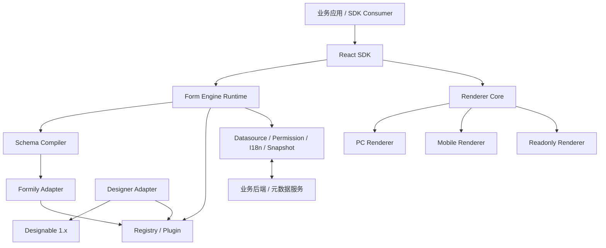
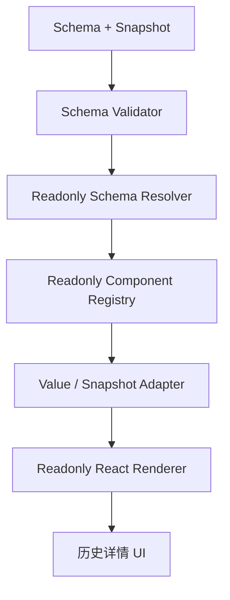

# Form Engine 企业级前端渲染引擎设计方案

> 技术栈：React + TypeScript + Formily 2.x + Designable 1.x  
> 形态：Monorepo、PC / 移动 Web / 只读多端渲染  
> 文档状态：架构设计基线（接口为建议契约，落地前需按锁定依赖版本验证）

---

## 1. 建设目标与设计原则

### 1.1 建设目标

建设一套可扩展、可复用、可私有化部署的企业级 Form Engine，统一承载：

- 表单 Schema 的定义、编译、校验和运行。
- 基于 Formily 2.x 的编辑态表单渲染。
- 基于 Designable 1.x 的可视化设计器适配（上游无 2.x，见第 19 节）。
- PC、移动 Web 和只读场景的多端渲染。
- 业务组件、远程数据源、权限、国际化和插件扩展。
- 表单元数据、业务值、历史快照之间的数据适配。
- 对外提供稳定的 React SDK 和必要的底层扩展 API。

### 1.2 核心原则

1. **不重复实现 Formily**：保留 Formily 原生 Schema、Field、Effects、Reaction、校验和联动能力。
2. **引擎只扩展，不接管**：引擎负责平台能力、组件注册、扩展元数据编译和生命周期，不重写 Formily 内核。
3. **组件定义统一**：设计器、编辑态渲染器、移动端和只读渲染器共享同一份组件定义。
4. **平台实现隔离**：PC、Mobile、Readonly 实现分离，业务语义和数据协议保持一致。
5. **快照可复现**：历史表单展示以提交时快照为准，避免依赖当前组件配置或实时数据源导致历史内容漂移。
6. **依赖方向单向**：底层类型和运行时不依赖具体 UI 库；设计器不反向依赖渲染器。
7. **开放但可治理**：允许注册自定义 React 组件，但必须经过 Adapter、Schema 定义和能力声明。
8. **接口稳定优先**：公共 API 与内部实现分离，避免业务项目直接依赖内部包。

---

## 2. 总体架构



### 2.1 分层职责

| 层 | 职责 | 不应承担的职责 |
|---|---|---|
| Types | 公共类型、协议、错误码 | React、UI、网络请求 |
| Core | Registry、Plugin、Context、Scope、事件 | 具体表单 UI |
| Formily Adapter | 引擎扩展与 Formily 原生能力适配 | 重写 Formily 内核 |
| Renderer | Schema 解析、组件映射、渲染生命周期 | 设计器拖拽编排 |
| Designer | Designable 适配、物料、Setter | 运行时业务提交 |
| Services | 数据源、权限、国际化、快照 | 组件视觉实现 |
| SDK | 对外统一入口和稳定 API | 业务接口的具体实现 |

---

## 3. Monorepo 目录结构

建议使用 pnpm workspace 管理，采用按职责拆包的方式。

```text
form-engine/
├── apps/
│   ├── playground/                 # 开发调试应用
│   ├── designer-demo/               # 设计器示例
│   └── renderer-demo/               # 渲染器示例
├── packages/
│   ├── types/                       # 公共类型和协议
│   ├── core/
│   │   ├── registry/                # 组件、装饰器、服务注册
│   │   ├── plugin/                  # 插件系统
│   │   ├── context/                 # Engine / Runtime Context
│   │   ├── scope/                   # Scope 管理
│   │   ├── events/                  # 事件系统
│   │   └── runtime/                 # 引擎实例与生命周期
│   ├── schema/
│   │   ├── compiler/                # x-engine 扩展编译
│   │   ├── validator/               # Schema 校验
│   │   └── migration/               # Schema 版本迁移
│   ├── formily/
│   │   ├── adapter/                 # Formily 适配层
│   │   ├── effects/                 # 内置 Effects
│   │   └── hooks/                   # 引擎 Hooks
│   ├── renderer/
│   │   ├── core/                    # 与 UI 无关的渲染逻辑
│   │   ├── react/                   # React 渲染入口
│   │   ├── pc/                      # PC 组件实现
│   │   ├── mobile/                  # 移动端组件实现
│   │   └── readonly/                # 独立只读渲染器
│   ├── designer/
│   │   ├── core/                    # 设计器领域模型
│   │   ├── designable-adapter/      # Designable 适配
│   │   ├── materials/               # 设计器物料
│   │   └── setters/                 # 属性配置器
│   ├── adapters/
│   │   ├── value/                   # 业务值适配
│   │   ├── snapshot/                # 快照适配
│   │   └── datasource/              # 数据源适配
│   ├── components/
│   │   ├── definitions/             # 组件统一定义
│   │   ├── basic/                   # 基础组件
│   │   ├── organization/            # 组织人员组件
│   │   ├── business/                # 业务组件
│   │   ├── pc/
│   │   ├── mobile/
│   │   └── readonly/
│   ├── services/
│   │   ├── datasource/
│   │   ├── permission/
│   │   ├── i18n/
│   │   └── snapshot/
│   └── sdk/
│       ├── react/
│       ├── designer/
│       └── types/
├── docs/
├── scripts/
├── pnpm-workspace.yaml
├── package.json
├── tsconfig.base.json
└── README.md
```

### 3.1 包依赖约束

- `types` 不依赖任何业务包。
- `core/registry` 不依赖 React。
- `core/context` 不依赖具体 UI 组件库。
- `renderer/core` 不依赖 Ant Design。
- `formily/adapter` 不依赖 Designable。
- `designer` 可以依赖 `types`、`core` 和 Designable Adapter，但不反向依赖 Renderer。
- 组件定义包不应把 PC 组件实现作为唯一实现。
- SDK 是业务项目的主要依赖入口，内部包不建议由业务项目直接引用。

---

## 4. 核心领域模型与类型契约

以下为建议接口，具体泛型和 Formily 类型导入需结合项目锁定的版本完善。

### 4.1 组件定义

```ts
export type Platform = 'pc' | 'mobile' | 'readonly';

export interface ComponentCapabilities {
  editable: boolean;
  readonly: boolean;
  mobile: boolean;
  datasource: boolean;
  validation: boolean;
  snapshot: boolean;
}

export interface ComponentMeta {
  title: string;
  description?: string;
  category?: string;
  icon?: string;
  tags?: string[];
}

export interface ComponentSchemaDefinition {
  type: 'object';
  properties?: Record<string, unknown>;
  default?: Record<string, unknown>;
}

export interface ComponentImplementations {
  pc?: React.ComponentType<any>;
  mobile?: React.ComponentType<any>;
  readonly?: React.ComponentType<any>;
}

export interface ComponentAdapter<Value = unknown, Snapshot = unknown> {
  normalizeValue?(value: unknown, context: AdapterContext): Value;
  serializeValue?(value: Value, context: AdapterContext): unknown;
  createSnapshot?(value: Value, context: AdapterContext): Snapshot;
  restoreSnapshot?(snapshot: Snapshot, context: AdapterContext): Value;
}

export interface FormComponentDefinition {
  name: string;
  version: string;
  meta: ComponentMeta;
  capabilities: ComponentCapabilities;
  schema: ComponentSchemaDefinition;
  implementations: ComponentImplementations;
  adapter?: ComponentAdapter;
}
```

### 4.2 组件定义示例：UserSelect

```ts
export const UserSelectDefinition: FormComponentDefinition = {
  name: 'UserSelect',
  version: '1.0.0',
  meta: {
    title: '人员选择',
    category: 'organization',
    description: '从组织架构中选择人员',
  },
  capabilities: {
    editable: true,
    readonly: true,
    mobile: true,
    datasource: true,
    validation: true,
    snapshot: true,
  },
  schema: {
    type: 'object',
    properties: {
      multiple: { type: 'boolean', default: false },
      datasource: { type: 'object' },
      placeholder: { type: 'string' },
    },
  },
  implementations: {
    pc: UserSelectPC,
    mobile: UserSelectMobile,
    readonly: UserSelectReadonly,
  },
  adapter: UserSelectAdapter,
};
```

### 4.3 组件注册

```ts
export interface ComponentRegistry {
  register(definition: FormComponentDefinition): void;
  unregister(name: string): void;
  get(name: string): FormComponentDefinition | undefined;
  has(name: string): boolean;
  list(): FormComponentDefinition[];
}
```

注册时应校验：

- 组件名称是否重复。
- 版本是否兼容。
- Schema 定义是否有效。
- 声明支持的平台是否提供对应实现。
- 声明支持快照的组件是否提供快照适配能力。
- 插件依赖是否已满足。

---

## 5. Registry 与 Plugin 系统

### 5.1 Registry 分类

建议统一 Registry 门面，内部按类型拆分：

| Registry | 内容 |
|---|---|
| ComponentRegistry | 字段组件与布局组件 |
| DecoratorRegistry | Formily 装饰器 |
| ServiceRegistry | 数据源、权限、国际化等服务 |
| FormatterRegistry | 只读格式化器 |
| ScopeRegistry | 引擎级、应用级、自定义 Scope |
| DesignerRegistry | 设计器物料与 Setter |

### 5.2 Plugin 接口

```ts
export interface FormEnginePlugin {
  name: string;
  version: string;
  dependencies?: string[];

  install(context: PluginContext): void | Promise<void>;
  dispose?(context: PluginContext): void | Promise<void>;
}

export interface PluginContext {
  registry: EngineRegistry;
  services: ServiceRegistry;
  events: EventBus;
  config: EngineConfig;
}
```

### 5.3 插件生命周期

1. 检查插件名称和版本。
2. 检查依赖插件是否存在。
3. 检查 Registry 注册冲突。
4. 创建安装事务或记录已注册资源。
5. 执行 `install`。
6. 安装失败时回滚本次已注册资源。
7. 引擎销毁时按逆序执行 `dispose`。

插件不得随意修改其他插件内部状态。跨插件通信应通过公开服务、Registry 或事件完成。

---

## 6. Schema 设计与编译策略

### 6.1 Schema 分层

Schema 同时承载 Formily 原生定义和引擎扩展信息，但应明确边界：

- **Formily Native**：`type`、`x-component`、`x-decorator`、`x-reactions`、`x-validator`、`x-visible` 等原生能力。
- **Engine Extension**：统一放入 `x-engine`。
- **Designer Metadata**：设计器专属元数据，可单独存储或放入受控扩展字段。

示例：

```json
{
  "type": "object",
  "properties": {
    "applicant": {
      "type": "string",
      "title": "申请人",
      "x-component": "UserSelect",
      "x-component-props": {
        "multiple": false
      },
      "x-engine": {
        "platform": {
          "pc": { "visible": true },
          "mobile": { "visible": true }
        },
        "readonly": {
          "display": "text"
        },
        "snapshot": {
          "strategy": "component"
        },
        "permission": {
          "read": true,
          "write": false
        },
        "datasource": {
          "type": "remote",
          "service": "organization.users"
        }
      }
    }
  }
}
```

### 6.2 SchemaCompiler 职责

SchemaCompiler 只处理引擎扩展，不替代 Formily Schema 解析器。

建议处理步骤：

1. 校验 Schema 版本与结构。
2. 读取 `x-engine`。
3. 按目标平台合并平台配置。
4. 解析组件定义和能力声明。
5. 处理权限、只读和数据源扩展。
6. 生成 Formily 可消费的 Schema 与运行时辅助元数据。
7. 保留原始 Schema，便于设计器回写和版本迁移。

### 6.3 配置优先级

建议从低到高：

1. 组件默认值。
2. 组件定义默认值。
3. Schema 通用配置。
4. `x-engine.platform` 平台配置。
5. 运行时应用级覆盖配置。
6. 权限策略计算结果。

权限结果不应简单被普通组件属性覆盖。权限属于安全与业务策略，最终仍需后端校验。

---

## 7. Formily Adapter

### 7.1 定位

Formily Adapter 负责连接引擎与 Formily：

- 将引擎组件 Registry 映射到 Formily `components`。
- 将引擎装饰器映射到 Formily `decorators`。
- 将 Scope、服务和扩展上下文注入 Formily。
- 提供引擎级 Effects。
- 处理引擎扩展 Schema 与 Formily 原生 Schema 的适配。

### 7.2 使用原则

保留并开放 Formily 原生能力，包括但不限于：

- `createForm`
- `createSchemaField`
- `FormProvider`
- `Field`
- `ObjectField`
- `ArrayField`
- `VoidField`
- `useForm`
- `useField`
- `useFieldSchema`
- `useFormEffects`
- `onFieldInit`
- `onFieldValueChange`
- `onFieldReact`
- `onFormValuesChange`

> 上述 API 的导入来源与签名（已按 `@formily/core@2.3.7` / `@formily/react@2.3.7` 验证）：
>
> - `@formily/core`：`createForm`、`onFieldInit`、`onFieldValueChange`、`onFieldReact`、`onFormValuesChange`、`onFormInit`、`onFormMount`、`onFormReact` 等表单工厂与生命周期。
> - `@formily/react`：`createSchemaField`、`FormProvider`、`Field`、`ObjectField`、`ArrayField`、`VoidField`、`useForm`、`useField`、`useFieldSchema`、`useFormEffects` 等 React 绑定。
> - `onFormValuesChange` 的回调签名是 `(form: Form) => void`，值从 `form.values` 读取，不是 `(form, values) => void`。
> - `useField` / `useFieldSchema` 必须位于字段渲染上下文内（如自定义字段组件或 `<Field>` 子树），仅在 `FormProvider` 下会取到空值。
>
> 不要把引擎自定义 API 误称为 Formily 原生 API；具体导出与签名仍以项目锁定的 Formily 版本为准。

### 7.3 适配示意

```tsx
const SchemaField = createSchemaField({
  components: engine.registry.getFormilyComponents('pc'),
  scope: engine.scope.toFormilyScope(),
});

function FormilyRenderer({ schema, form }: Props) {
  return (
    <FormProvider form={form}>
      <SchemaField schema={schema} />
    </FormProvider>
  );
}
```

`createSchemaField` 返回的是 React 组件，应使用 JSX 渲染（不要用 `schemaField({ schema })` 函数式调用，它绕过 React 组件边界，无法保证 Hooks/Context 语义）。`scope` 既可在工厂级 `createSchemaField({ scope })` 注入，也可在实例级 `<SchemaField schema={...} scope={...} />` 注入，实例级覆盖工厂级同名 key。以上仍以实际依赖版本为准。

---

## 8. Renderer 设计

### 8.1 渲染模式

| 模式 | 目标 | 是否创建编辑态 Formily Form |
|---|---|---|
| edit | 用户填写、联动、校验 | 是 |
| preview | 设计器预览 | 通常是，受控模拟数据 |
| readonly | 历史详情、审批详情 | 否，使用独立只读渲染器 |

### 8.2 Renderer Props

```ts
export interface FormRendererProps {
  schema: Record<string, unknown>;
  mode?: 'edit' | 'preview' | 'readonly';
  platform?: 'pc' | 'mobile';
  initialValues?: Record<string, unknown>;
  snapshot?: FormSnapshot;
  disabled?: boolean;
  readOnly?: boolean;
  scope?: Record<string, unknown>;
  onValuesChange?: (values: Record<string, unknown>) => void;
}
```

### 8.3 Renderer Instance API

```ts
export interface FormRendererInstance {
  getValues(): Record<string, unknown>;
  setValues(values: Record<string, unknown>): void;
  validate(): Promise<void>;
  reset(): void;
  submit(): Promise<FormSubmitResult>;
  getFormilyForm(): unknown;
  destroy(): void;
}
```

`getFormilyForm()` 可作为高级逃生口，但应明确其与 Formily 版本绑定，普通业务不应依赖该接口。

### 8.4 Form 生命周期

- 每个 Renderer 实例独立创建和管理 Formily Form。
- `FormEngineProvider` 提供 Engine，不应持有所有 Renderer 共用的 Form 实例。
- Schema 发生结构性变化时，应明确是重建 Form 还是执行受控迁移。
- 数据更新应区分初始化赋值和用户编辑，避免重复触发联动。
- `submit()` 只负责校验、获取 Value、生成 Snapshot 并返回结果，不直接发起业务 HTTP 请求。

---

## 9. 独立只读渲染器

### 9.1 为什么独立

只读展示与编辑态并非简单的 `disabled=true`：

- 历史记录应展示提交时的标签、名称和选项文本。
- 不应触发编辑态 Reactions、Effects 或远程搜索。
- 不应创建编辑态 Formily Form。
- 应支持不同于编辑态的布局和展示组件。
- 应尽量避免实时数据源变化影响历史数据。

### 9.2 只读渲染流程



### 9.3 只读组件协议

只读组件应以稳定的展示模型为输入：

```ts
export interface ReadonlyComponentProps<Value = unknown> {
  value: Value;
  snapshotValue?: unknown;
  schema: Record<string, unknown>;
  locale?: string;
  context: ReadonlyRenderContext;
}
```

建议只读渲染器提供独立 `FormatterRegistry`，例如：

- 日期时间格式化。
- 金额格式化。
- 人员、部门、角色展示。
- 字典值转标签。
- 文件列表展示。
- 地址和地理位置展示。

---

## 10. Runtime Context 与 Scope

### 10.1 Runtime Context

```ts
export interface FormEngineContext {
  engine: FormEngine;
  platform: Platform;
  mode: 'edit' | 'preview' | 'readonly';
  locale: string;
  services: EngineServices;
  permissions: PermissionContext;
}
```

### 10.2 Scope 命名空间

建议按优先级和用途隔离：

- `engine`：引擎内置能力。
- `app`：业务应用注入能力。
- `custom`：业务自定义方法和数据。

避免将所有方法直接平铺到同一个对象，减少命名冲突和权限边界不清晰的问题。

---

## 11. 数据源服务

### 11.1 统一数据源协议

```ts
export interface DatasourceRequest {
  service: string;
  params?: Record<string, unknown>;
  keyword?: string;
  page?: number;
  pageSize?: number;
  signal?: AbortSignal;
}

export interface DatasourceResult<T = unknown> {
  items: T[];
  total?: number;
  hasMore?: boolean;
}

export interface DatasourceService {
  query<T = unknown>(
    request: DatasourceRequest
  ): Promise<DatasourceResult<T>>;
}
```

### 11.2 设计要求

- 组件只声明数据源标识和参数，不直接耦合具体 HTTP URL。
- 由应用注入 DatasourceService，实现鉴权、租户、错误处理和请求追踪。
- 支持关键字搜索、分页、取消请求和防抖。
- 对字典、人员、部门等常用数据提供缓存策略。
- 历史只读展示优先读取 Snapshot，不应默认重新请求当前数据源。

---

## 12. Value 与 Snapshot 协议

### 12.1 三类数据必须区分

| 数据 | 含义 | 典型用途 |
|---|---|---|
| Schema | 表单结构和配置 | 表单定义、渲染 |
| Value | 用户提交的业务值 | 业务查询、审批处理 |
| Snapshot | 提交时结构与展示信息的冻结数据 | 历史详情、审计、回放 |

不要把 Snapshot 当成 Value 的简单副本，也不要让业务后端只保存无法独立展示的 ID。

### 12.2 Snapshot 建议结构

```ts
export interface FormSnapshot {
  snapshotVersion: string;
  schemaId: string;
  schemaVersion: number;
  createdAt: string;
  locale?: string;
  values: Record<string, unknown>;
  fields: Record<string, FieldSnapshot>;
}

export interface FieldSnapshot {
  path: string;
  component: string;
  title?: string;
  value: unknown;
  displayValue?: unknown;
  options?: Array<{
    label: string;
    value: unknown;
  }>;
  metadata?: Record<string, unknown>;
}
```

### 12.3 人员选择快照示例

业务 Value：

```json
{
  "applicant": "u_10001"
}
```

Snapshot：

```json
{
  "applicant": {
    "path": "applicant",
    "component": "UserSelect",
    "value": "u_10001",
    "displayValue": {
      "id": "u_10001",
      "name": "张三",
      "departmentName": "研发部"
    }
  }
}
```

对于多选人员，`value` 保存稳定 ID 数组，`displayValue` 保存提交时的展示信息数组。

### 12.4 快照生成原则

1. Value 保存业务需要的稳定值。
2. Snapshot 保存历史展示所需的冻结信息。
3. 组件通过 Adapter 生成快照，不由页面逐个拼装。
4. 快照记录 Schema 版本和 Snapshot 版本。
5. Snapshot 应支持向前兼容读取和显式迁移。
6. 快照生成失败时，应根据业务重要性决定阻断提交还是记录降级错误；审批、审计类业务通常应阻断或采用明确的降级策略。
7. Snapshot 不应保存敏感信息的冗余副本，需遵循数据最小化和权限控制。

---

## 13. Designer 与 Designable Adapter

### 13.1 设计器职责

- 物料面板和组件拖拽。
- 节点树和 Schema 结构维护。
- 属性 Setter 配置。
- 组件校验和配置提示。
- 平台配置编辑。
- 预览和 Schema 导入导出。
- Schema 版本管理。

### 13.2 统一组件定义

设计器不维护一套与 Renderer 脱节的组件清单。组件 Definition 应同时提供：

- 运行时组件信息。
- Schema 属性定义。
- 设计器物料信息。
- Setter 配置。
- 平台能力声明。
- Snapshot Adapter 能力。

### 13.3 Designer Material

```ts
export interface DesignerMaterialDefinition {
  componentName: string;
  title: string;
  category: string;
  icon?: string;
  defaultSchema: Record<string, unknown>;
  setters?: SetterDefinition[];
}
```

Designable Adapter 负责把上述定义转换成 Designable 1.x 可消费的物料和节点配置。具体 API 需按实际 Designable 版本验证。

### 13.4 落地约束（已验证）

按 `@designable/*@1.0.0-beta.45` 验证，设计器适配需遵守以下约束：

- **技术栈绑定**：Designable 上游 peer 依赖 React 16.x/17.x、antd 4.x，最后发布于 2022 年；设计器应作为独立应用或懒加载模块，不进入运行时 Renderer 的主包。
- **构建链路**：Designable 与 `@formily/antd` 的 CJS 产物直接 `require('.less')`，Node/SSR 无法直接解析；需使用 ESM 产物并配置 less/CSS 处理，且必须开启 `skipLibCheck`。
- **初始化顺序**：`Engine.setCurrentTree()` 在未创建 workspace 时是空操作，需先 `workbench.ensureWorkspace(...)` / `addWorkspace(...)` 再设置节点树，否则画布静默为空。
- **Setter 上下文依赖**：`ValidatorSetter` 依赖 Formily `useField()`（读取 `field.title`），`ReactionsSetter` / `DataSourceSetter` 依赖 Designable Designer/Theme 上下文；不能脱离对应 Provider 独立挂载。
- **节点 ID 语义**：`x-designable-id` 是设计器内部节点标识，不参与业务 Value / Snapshot 语义，渲染器编译时应忽略。

更完整结论见 `docs/tech-design/verification/04-designable.md`。

---

## 14. SDK 公共 API

建议业务项目优先通过 SDK 使用引擎。

```ts
export interface FormEngineOptions {
  platform?: Platform;
  locale?: string;
  plugins?: FormEnginePlugin[];
  components?: FormComponentDefinition[];
  services?: Partial<EngineServices>;
}

export function createFormEngine(
  options: FormEngineOptions
): FormEngine;
```

React 使用示例：

```tsx
const engine = createFormEngine({
  platform: 'pc',
  locale: 'zh-CN',
  components: [UserSelectDefinition],
  services: {
    datasource: appDatasourceService,
  },
});

function App() {
  return (
    <FormEngineProvider engine={engine}>
      <FormRenderer
        schema={schema}
        mode="edit"
        initialValues={initialValues}
      />
    </FormEngineProvider>
  );
}
```

提交示例：

```ts
const result = await rendererRef.current?.submit();

// 业务层决定如何调用后端
await api.saveForm({
  values: result.values,
  snapshot: result.snapshot,
});
```

建议 SDK 导出：

- `createFormEngine`
- `FormEngineProvider`
- `FormRenderer`
- `ReadonlyRenderer`
- `Designer`
- 公共类型
- 组件注册和插件注册接口
- 受控的 Hooks

---

## 15. 错误处理与可观测性

建议定义统一错误类型：

```ts
export type FormEngineErrorCode =
  | 'SCHEMA_INVALID'
  | 'COMPONENT_NOT_FOUND'
  | 'PLUGIN_CONFLICT'
  | 'PLUGIN_DEPENDENCY_MISSING'
  | 'DATASOURCE_FAILED'
  | 'SNAPSHOT_FAILED'
  | 'PERMISSION_DENIED'
  | 'RENDER_FAILED';

export class FormEngineError extends Error {
  constructor(
    public code: FormEngineErrorCode,
    message: string,
    public details?: unknown
  ) {
    super(message);
  }
}
```

日志和诊断建议覆盖：

- Engine 创建、插件安装和销毁。
- Schema 编译耗时和错误。
- 组件缺失和能力不匹配。
- 数据源请求耗时、失败和取消。
- Snapshot 生成耗时和失败。
- Renderer 生命周期。
- 设计器 Schema 变更。

生产环境日志应避免记录完整业务表单值和敏感字段。

---

## 16. 测试策略

| 测试层级 | 重点 |
|---|---|
| Unit | Registry、Plugin、Compiler、Adapter、Formatter |
| Component | PC / Mobile / Readonly 组件行为 |
| Integration | Formily Adapter、Runtime、Datasource、Snapshot |
| E2E | 设计、发布、填写、提交、历史回显 |
| Compatibility | Formily / Designable 版本兼容、旧 Schema 迁移 |

### 16.1 必须覆盖的关键场景

- Formily 原生 Schema 能力不回归。
- `x-reactions` 和动态必填规则正常工作。
- 自定义组件可通过 Registry + Adapter 接入。
- PC 与移动端 Value 结构一致。
- 人员、部门、字典等远程组件支持搜索和分页。
- 组件快照可独立完成历史展示。
- 历史展示不因当前字典或组织架构变化而漂移。
- 无只读实现的组件有明确降级或报错策略。
- 插件冲突和安装失败可以回滚。
- Schema 版本升级后旧数据仍可读取。

---

## 17. 研发实施阶段

### M1：核心渲染引擎

交付：

- Monorepo 工程和构建体系。
- 公共 Types。
- Component Registry。
- Plugin System。
- Runtime Context / Scope。
- Formily Adapter。
- PC Renderer 基础能力。
- 基础组件集。
- SDK 最小公共 API。

验收：

- 能注册内置和自定义组件。
- 能渲染 Formily 原生 Schema。
- 能执行原生校验、联动和 Effects。
- 能通过 SDK 创建 Engine 和 Renderer。
- 单元测试和基础集成测试通过。

### M2：设计器、只读与数据适配

交付：

- Designable Adapter。
- Designer Materials / Setters。
- Mobile Renderer。
- Readonly Renderer。
- Datasource Service。
- Value Adapter。
- Snapshot Adapter。
- Schema 版本和迁移基础能力。

验收：

- 设计器产出的 Schema 可被 Renderer 消费。
- PC 与移动端提交值结构一致。
- 提交结果包含 Value 和 Snapshot。
- 只读渲染器可使用历史 Snapshot 展示数据。
- 远程人员、部门和字典组件可用。

### M3：SDK 开放与生产化

交付：

- 插件扩展规范。
- 自定义组件开发文档。
- 权限和国际化服务。
- Devtools / 调试能力。
- 性能优化。
- E2E 和兼容性测试。
- Schema / Snapshot 迁移工具。
- 发布、版本管理和变更日志规范。

验收：

- 外部业务项目可独立接入 SDK。
- 第三方组件可按规范扩展。
- 插件安装、卸载和冲突处理稳定。
- 历史表单可长期兼容。
- 生产环境具备必要的监控、错误定位和回滚能力。

---

## 18. 建议拆分的后续设计文档

建议将本总设计拆成可评审、可分工的专题文档：

1. `01-types.md`：公共类型、领域模型和错误协议。
2. `02-component-spec.md`：组件定义、Adapter 和组件开发规范。
3. `03-registry-plugin.md`：Registry、Plugin 生命周期与冲突策略。
4. `04-formily-adapter.md`：Formily 2.x 适配、原生能力和 Effects。
5. `05-renderer-sdk.md`：Renderer、实例 API 和 SDK。
6. `06-runtime-context.md`：Context、Scope、事件和服务注入。
7. `07-designer-adapter.md`：Designable 1.x 适配、物料和 Setter。
8. `08-readonly-renderer.md`：只读渲染和 Formatter。
9. `09-value-snapshot.md`：Value、Snapshot、后端存储与历史回显协议。
10. `10-testing-and-roadmap.md`：测试策略、验收标准和研发计划。

建议优先完成 `01` 至 `04`，先稳定公共契约和 Formily 适配边界，再并行推进 Renderer、Designer 和 Snapshot。

---

## 19. 落地前需要锁定和验证的事项

本方案是架构基线，不等同于已经验证过的可编译实现。正式开发前应完成以下技术验证：

- 锁定 React、TypeScript、Formily 2.x、Designable 1.x 的具体版本（上游无 Designable 2.x，最新为 1.0.0-beta.45）。
- 核对 Formily API 的实际导出位置、参数类型和 SchemaField Scope 传递方式。
- 用最小 Demo 验证 `x-reactions`、自定义组件、Effects 和动态校验。
- 验证 Designable 物料、Setter 与 Schema 回写机制。
- 明确 Schema、Value、Snapshot 的后端持久化边界。
- 明确人员、部门、字典等组件的 Value 标准及 Snapshot 标准。
- 明确权限规则由前端展示控制还是后端强制执行；业务安全必须由后端兜底。
- 明确 Schema 和 Snapshot 的版本升级、迁移及兼容窗口。
- 评估 Designable 上游维护状态与 fork 策略（最后发布 2022-02-28，无 React 18 / antd 5 支持）。

> 上述事项已完成一次技术验证，结论与过程见 `docs/tech-design/verification/README.md`。其中 Designable 版本、Formily API 签名与设计器构建约束已按验证结果修订到本文。

**最终建议：** 先以 `types + component definition + registry/plugin + formily adapter` 建立稳定内核，再实现多端 Renderer 和 Designer；不要在第一阶段同时把所有业务组件、设计器能力和后端快照协议全部做完。
