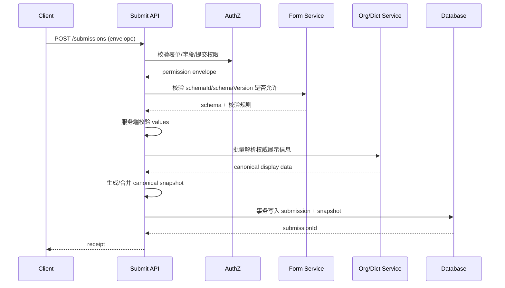

# 05. Schema / Value / Snapshot 后端持久化边界

> 对应第 19 节第 5 项：明确 Schema、Value、Snapshot 的后端持久化边界。

## 1. 验证目标与方式

本项没有可运行的后端，因此采用**协议推演 + 与现有规格对照**的方式，确认：

1. 三类数据分别由谁产生、由谁存储、是否可变；
2. 提交时前端与后端各自负责什么；
3. 历史展示、重新编辑、审计回放分别读取什么；
4. 事务、幂等和失败策略是否有明确边界。

参考：`docs/tech-design/02-specs/09-value-snapshot.md`。

**结论性质：协议建议，需要后端与业务方评审确认，不能视为已联调验证。**

## 2. 三类数据的权威归属

| 数据 | 权威来源 | 存储位置 | 可变性 | 主要读取方 |
|---|---|---|---|---|
| Schema | 表单定义服务 / 设计器发布 | `form_schema_version.schema_json` | 发布后不可变；新版本新增记录 | 编辑态 Renderer、设计器、迁移工具 |
| Value | 用户提交 + 后端业务校验 | `form_submission.values_json` | 每次提交不可变；草稿单独存储 | 业务计算、查询、审批 |
| Snapshot | 提交时冻结 + 后端权威补全 | `form_submission.snapshot_json` | 提交后不可变 | 历史详情、审批详情、审计 |
| 权限 | 后端权限服务 | 不入库到 Snapshot | 实时计算 | 前端 UI 收敛 + 后端强制校验 |

**边界原则：**

1. Schema 只按版本存一份，Snapshot 通过 `schemaId + schemaVersion` 引用，不复制完整 Schema。
2. Value 只保存稳定业务值，不保存展示名称。
3. Snapshot 保存历史展示所需的最小冻结信息，不依赖当前组织架构、字典或组件配置。
4. 权限不是 Snapshot 的一部分，历史详情读取时仍需后端鉴权。

## 3. 建议存储模型

```text
form_definition
- id
- form_key
- name
- status
- created_at
- updated_at

form_schema_version
- id
- form_id
- version
- engine_schema_version
- schema_json
- schema_hash
- published_at
- created_by

form_instance
- id
- form_id
- form_version
- business_id
- status
- created_at
- updated_at

form_submission
- id
- instance_id
- schema_id
- schema_version
- engine_schema_version
- snapshot_version
- values_json
- snapshot_json
- idempotency_key
- submitted_by
- submitted_at
- request_hash

-- 草稿单独存储，避免未提交数据污染正式提交记录
form_draft
- id
- instance_id
- schema_version
- values_json
- updated_by
- updated_at
```

关键约束：

- `form_schema_version` 发布后只读；修改必须产生新版本。
- `form_submission` 插入后不更新 `values_json` / `snapshot_json`；更正通过新提交或业务冲正记录完成。
- `form_submission(instance_id, idempotency_key)` 唯一，用于幂等提交。
- `snapshot_json` 与 `values_json` 在同一事务内写入。
- `request_hash` 用于识别“同一幂等键但请求体不同”的冲突。

## 4. 提交协议

### 4.1 前端提交信封

```json
{
  "formKey": "leave-form",
  "formInstanceId": "fi_10001",
  "schemaId": "leave-form",
  "schemaVersion": 3,
  "engineSchemaVersion": "1.0.0",
  "idempotencyKey": "0f8fad5b-d9cb-469f-a165-70867728950e",
  "values": {
    "applicant": "u_10001",
    "leaveType": 1,
    "period": {
      "start": "2026-11-10",
      "end": "2026-11-11"
    }
  },
  "snapshot": {
    "snapshotVersion": "1.0",
    "schemaId": "leave-form",
    "schemaVersion": 3,
    "createdAt": "2026-11-07T09:00:00.000Z",
    "values": {
      "applicant": "u_10001",
      "leaveType": 1,
      "period": {
        "start": "2026-11-10",
        "end": "2026-11-11"
      }
    },
    "fields": {
      "applicant": {
        "path": "applicant",
        "component": "UserSelect",
        "value": "u_10001",
        "displayValue": {
          "id": "u_10001",
          "name": "张三",
          "departmentName": "研发部"
        }
      }
    }
  }
}
```

约束：

- `values` 与 `snapshot.values` 在提交时必须一致；由引擎 `submit()` 保证。
- `snapshot` 不包含完整 Schema。
- `idempotencyKey` 由调用方生成，同一次用户提交重试必须复用。
- 前端生成的 `displayValue` 是**候选展示信息**，不是权威身份数据。

### 4.2 后端处理顺序



**后端必须做的事：**

1. 鉴权：读取、字段写权限、提交权限、审批权限。
2. 版本校验：`schemaId + schemaVersion` 对当前实例是否允许。
3. 业务校验：必填、类型、范围、跨字段规则、唯一性。
4. 权威展示信息补全：人员、部门、字典等以服务端数据为准。
5. 幂等：按 `(instanceId, idempotencyKey)` 去重；请求体不一致时报冲突。
6. 原子持久化：Value 与 Snapshot 同事务。
7. 敏感字段脱敏/加密与访问审计。

**前端只做的事：**

1. 编译 `x-engine` 并渲染。
2. 做即时 UX 校验。
3. 通过 Adapter 规范化 Value。
4. 生成候选 Snapshot。
5. 提交信封并处理 receipt。
6. 不直接决定权限、不直接写权威组织信息。

## 5. 读取路径边界

| 场景 | 读取内容 | 不应读取 |
|---|---|---|
| 业务查询/计算 | `form_submission.values_json` | 不依赖 Snapshot 展示字段 |
| 历史详情/审批详情 | `snapshot_json` | 不查当前字典、当前组织、当前组件配置 |
| 重新编辑 | `form_schema_version.schema_json` + `values_json` | 不用 Snapshot 反向还原业务值 |
| 审计回放 | Snapshot + Schema 版本 + 提交记录 | 不以迁移后的数据覆盖原始记录 |
| 设计器打开旧表单 | Schema 版本 | 不修改历史业务实例的 Schema |

**历史展示优先级**（与只读渲染器规格一致）：

```text
Snapshot.displayValue
  → 组件快照元数据
  → Schema 静态规则
  → 显式允许的兼容查询
  → 原始值 + 诊断信息
```

## 6. 失败与降级策略

| 场景 | 建议策略 |
|---|---|
| Snapshot 生成失败（审批/审计） | 阻断提交，返回可诊断错误 |
| Snapshot 生成失败（低风险草稿） | 允许保存草稿，标记 `snapshotPending` |
| 后端权威展示信息解析失败 | 保留 ID，标记 `displayMissing`，不伪造名称 |
| Schema 版本已停用 | 拒绝重新编辑；历史展示仍可读 Snapshot |
| 幂等键冲突且请求体不同 | 返回 409，不覆盖已有提交 |
| 快照读取无权限 | 返回 403，不返回部分字段 |

## 7. 与现有规格的一致性检查

| 现有规格 | 本项结论 | 是否一致 |
|---|---|---|
| 09 §3 建议存储模型 | 保留并补充 `schema_id`、`request_hash`、`form_draft` | 一致，属细化 |
| 09 §6 Value 与 Snapshot 同次提交 | 明确同事务写入 | 一致 |
| 09 §8 保留原始快照 | 明确 `form_submission` 提交后不可变 | 一致 |
| 09 §9 幂等提交 | 明确 `(instance_id, idempotency_key)` 唯一 | 一致 |
| 09 §10 访问 Snapshot 必须鉴权 | 明确权限不入 Snapshot | 一致 |
| 只读渲染器“优先 Snapshot” | 明确历史详情不查实时数据源 | 一致 |

## 8. 待确认问题

1. **权威展示信息由谁生成**：提交时后端批量解析，还是由专门的组织/字典快照服务提供？
2. **Schema 版本保留期限**：历史回放需要保留多久？过期后是否只保留 Snapshot 展示信息？
3. **草稿是否需要 Snapshot**：建议不需要，但需产品确认。
4. **敏感字段策略**：Snapshot 中是脱敏、加密还是只存引用？
5. **跨租户/跨环境迁移**：Snapshot 中的 ID 是否需要命名空间前缀？
6. **提交后更正**：采用新提交版本，还是允许原地修正并保留审计链？

## 9. 结论

**第 5 项结论：协议边界已明确，后端实现未验证。**

- Schema、Value、Snapshot 的权威归属、存储位置和读取路径已经可以形成后端接口契约。
- 前端不得生成权威展示信息；后端必须在提交时补全并校验。
- 在正式开发前，需要后端、安全、业务三方对第 8 节问题给出书面结论。
