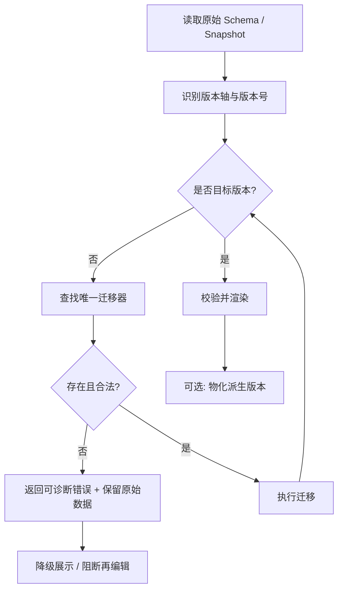

# 08. Schema / Snapshot 版本升级、迁移与兼容窗口

> 对应第 19 节第 8 项：明确 Schema 和 Snapshot 的版本升级、迁移及兼容窗口。

## 1. 验证目标

1. 区分不同的版本轴，避免用一个版本号承载所有语义；
2. 定义读取时的版本识别与有序迁移链；
3. 保证原始 Schema / Snapshot 不被覆盖；
4. 给出可执行的兼容窗口和失败策略；
5. 用可运行用例验证协议本身可行。

## 2. 验证方式

验证文件：`verification/src/08-migration-protocol.test.ts`。

本项验证的是**迁移协议**，不是某个真实历史数据集。共 8 个用例，全部通过：

```text
✓ 按注册顺序执行多跳迁移链
✓ 迁移不修改原始数据，便于保留历史快照
✓ 缺少迁移器时抛出可诊断错误，并保留原始数据
✓ 已是目标版本时为空操作
✓ 迁移器输出版本不符合声明时立即失败
✓ 检测迁移环，避免读取时死循环
✓ 同一起点的重复迁移器应被拒绝，避免执行顺序不确定
✓ schemaVersion 与 snapshotVersion 两条版本轴互不混用
```

## 3. 四条版本轴

| 版本轴 | 含义 | 谁维护 | 何时变化 |
|---|---|---|---|
| `schemaVersion` | 业务表单结构版本 | 表单定义 / 设计器发布 | 字段、布局、联动规则变化 |
| `engineSchemaVersion` | 引擎扩展协议版本（`x-engine` 语义） | 引擎团队 | 引擎扩展字段或语义破坏性变化 |
| `snapshotVersion` | Snapshot 载荷结构版本 | 引擎 / 快照协议 | Snapshot 字段结构变化 |
| `componentVersion` | 组件定义版本 | 组件库 | 组件 Value / Snapshot 适配变化 |

辅助信息（不参与迁移，只用于诊断）：

- `formilyVersion`
- `designableVersion`
- `rendererVersion`

**原则：**

1. 版本轴相互独立，不能用一个 `version` 字段混合表达。
2. 每个轴有独立的迁移注册表和目标版本。
3. 迁移器只能处理自己负责的轴。
4. 破坏性变更必须提升对应轴的版本，并提供迁移器或明确拒绝策略。

## 4. 迁移协议

### 4.1 注册表模型

```ts
interface Migration {
  axis: 'schema' | 'snapshot' | 'engineSchema' | 'component'
  from: string
  to: string
  migrate: (input: VersionedDocument) => VersionedDocument
}
```

约束：

- `(axis, from)` 唯一，出现多个迁移器时拒绝执行（避免顺序不确定）；
- 迁移器输出必须声明为 `to`，否则立即失败；
- 迁移链必须无环；
- 已是目标版本时为空操作；
- 迁移过程不得修改输入对象。

### 4.2 读取流程



### 4.3 迁移结果处理

- **不覆盖原始记录**：原始 Snapshot 永远保留；
- 可生成新的派生记录（如 `migrated_snapshot_json` 或缓存表），并记录 `migrationId` / `appliedAt`；
- 迁移失败时保留原始数据，返回结构化错误：

```ts
interface MigrationFailure {
  code:
    | 'NO_MIGRATION'
    | 'AMBIGUOUS_MIGRATION'
    | 'BAD_MIGRATOR_OUTPUT'
    | 'CYCLE_DETECTED'
  axis: string
  version: string
  message: string
}
```

## 5. 兼容窗口建议

### 5.1 Schema / engineSchema

| 情况 | 建议策略 |
|---|---|
| 当前版本 | 正常编辑、正常渲染 |
| 上一个主版本（N-1） | 可读、可渲染；编辑时提示升级；写入前迁移 |
| 更早版本 | 只读展示 Snapshot；禁止再编辑；要求离线迁移 |
| 未知 `x-engine` 协议 | 拒绝编辑，只读降级并输出诊断 |

建议窗口：**当前 + 上一个主版本**，具体时长由业务发布节奏决定。

### 5.2 Snapshot

| 情况 | 建议策略 |
|---|---|
| 有完整迁移链 | 读取时迁移后展示 |
| 缺少迁移器 | 原始展示 + 诊断；禁止基于该 Snapshot 重新提交 |
| 迁移校验失败 | 保留原始 + 告警；审核员可查看原始 JSON |
| 历史审计 | 始终保留原始版本，迁移结果只读派生 |

建议：**Snapshot 不做硬性截止**。历史数据可能长期存在，迁移器按需长期保留；但必须限制迁移器数量和执行时间。

### 5.3 Component

| 情况 | 建议策略 |
|---|---|
| 当前组件版本 | 正常渲染 |
| N-1 / N-2 次版本 | 保留实现或提供兼容层 |
| 未知组件 | 占位节点 + 诊断，不静默丢弃 |
| 组件 Value/Snapshot 语义变化 | 必须提升 `componentVersion` 并提供 Adapter 迁移 |

建议窗口：**保留最近 2 个次版本的实现或适配器**。

## 6. 迁移执行位置

| 方案 | 优点 | 风险 | 建议 |
|---|---|---|---|
| 前端读取时迁移 | 快速上线，后端无感 | 迁移逻辑分散、可被绕过、历史展示不一致 | 仅用于展示层兼容 |
| 后端读取时迁移 | 统一、可审计、可缓存 | 后端需感知 Schema 语义 | **推荐用于权威迁移** |
| 离线批处理 | 可控、可回滚 | 时效性差 | 用于大版本升级和清理 |

建议组合：

1. **展示层**：前端只读迁移，失败降级；
2. **业务层**：后端在重新编辑/提交前执行权威迁移；
3. **大版本**：离线批处理 + 双读校验 + 灰度。

## 7. 回滚与审计

- 迁移器版本化，已发布的迁移器不可修改；
- 每次迁移记录：原始版本、目标版本、迁移器 ID、执行时间、结果状态；
- 原始 Snapshot 永不覆盖；
- 迁移失败不产生半成品业务数据；
- 重要审批记录保留迁移前后校验信息；
- 灰度期间支持按 `schemaVersion` / `snapshotVersion` 维度回滚读取策略。

## 8. 测试矩阵

| 测试 | 目的 |
|---|---|
| 每个历史版本一个 fixture | 确保迁移链覆盖真实数据 |
| 多跳迁移链 | 验证顺序与幂等性 |
| 缺少迁移器 | 验证诊断与原始数据保留 |
| 迁移器输出错误版本 | 验证立即失败 |
| 循环迁移 | 验证不会死循环 |
| 同起点重复迁移器 | 验证拒绝歧义 |
| 多版本轴隔离 | 验证 schema 与 snapshot 不混用 |
| 迁移前后 Snapshot golden case | 验证展示字段不漂移 |

## 9. 待确认问题

1. `engineSchemaVersion` 由引擎团队还是平台团队维护？发布节奏如何对齐？
2. Schema 迁移由设计器、后端还是独立迁移服务执行？
3. Snapshot 迁移器需要保留多久？是否允许删除旧迁移器？
4. 迁移后的派生 Snapshot 是否落库？落库后如何失效？
5. 兼容窗口 N-1 的具体时长和通知机制？
6. 组件版本与 Schema 版本的兼容矩阵由谁维护？
7. 迁移失败的降级展示是否需要审核员可见的原始 JSON？

## 10. 结论

**第 8 项结论：协议级验证通过。**

- 四条版本轴可以独立演进；
- 有序迁移链、原始数据不可变、失败可诊断、环检测、歧义检测均可实现；
- 8 个协议用例全部通过；
- 兼容窗口建议为 Schema 当前 + N-1、Snapshot 长期按需、组件最近 2 个次版本；
- 权威迁移建议放在后端，前端只做展示层兼容。
